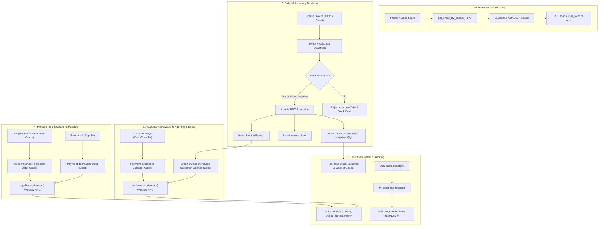

# Employee Management System — Application Summary, Database Schemas & Architecture

**System Name:** Employee Management System (نظام إدارة المبيعات والحسابات والمخزون)  
**Domain:** FMCG & Wholesale Food Distribution ERP  
**Technology Stack:** React 19, TypeScript, Vite 8, Supabase (PostgreSQL 15+, Auth, RLS, PostgREST), TanStack React Query, Tailwind CSS, Recharts, jsPDF  
**Target Environment:** Vercel Static Hosting + Supabase Managed Cloud  

---

## 1. Executive Summary

The **Employee Management System** is a production-grade, bilingual (Arabic RTL-first with English LTR support) enterprise resource planning (ERP) system tailored for distribution, trading, and wholesale companies.

It replaces fragmented paper ledgers and spreadsheets with a centralized, ACID-compliant database architecture. The system covers:
1. **Multi-Tenant Role-Based Access Control (RBAC):** Strict operational segregation between Managers (full administrative control) and Sales Representatives (strictly scoped read-only access to their assigned customers and catalogs).
2. **Double-Entry & Cumulative Accounting Ledger (كشف حساب تراكمي):** Chronological running-balance calculation for both accounts receivable (customers) and accounts payable (suppliers) using database window functions.
3. **Omni-Channel Invoicing & Cashflow Management:** Immediate cash sales (`cash_invoices`) vs. credit receivables (`credit_invoices`) with automated payment allocations and down payments.
4. **Perpetual Inventory & Stock Depletion Engine:** Itemized multi-line invoices, atomic stock deductions, supplier stock receipts with weighted-average cost (WAC/COGS) valuation, and manual adjustment audits.
5. **Supplier & Procurement Tracking (Accounts Payable):** Tracking vendor profiles, cash/credit purchases, and supplier disbursements.
6. **Executive Financial KPI Dashboard:** Real-time financial velocity metrics including Days Sales Outstanding (DSO), Receivables Aging buckets (0–30, 31–60, 61–90, 90+ days), Cash vs. Credit distributions, and Net Cashflow (Income vs. Outcome).
7. **Automated Immutable Audit Trail:** Database triggers capturing every `INSERT`, `UPDATE`, and `DELETE` event with full JSONB before/after snapshots and actor metadata.
8. **Print & Digital Document Generation:** Clean A4 printable catalog, account statements, invoice printing, and one-click WhatsApp sharing.

---

## 2. Core Architectural Principles

- **Database as the Single Source of Truth (SSOT) & Security Boundary:**
  Security is **never** delegated to frontend UI toggles or client code. PostgreSQL Row Level Security (RLS) policies and `SECURITY DEFINER` stored functions enforce tenancy and role-based permissions at the database engine level. If an unauthorized client attempts a direct PostgREST mutation, the database rejects it.
- **Exact Decimal Arithmetic:**
  All currency fields use PostgreSQL `numeric(14,2)` and inventory quantities use `numeric(14,4)`. Floating-point arithmetic (`float`, `real`, or JavaScript numbers) is strictly prohibited in database schemas to prevent rounding discrepancies in financial statements.
- **Multi-Tenant Manager Isolation:**
  Every core table includes an `owner_id` (foreign key to `auth.users(id)`). Each manager operates an isolated tenant organization; representatives inherit their manager's `owner_id`. Cross-tenant data leaks are physically blocked by RLS.
- **Bilingual RTL-First Ergonomics:**
  Designed natively for Arabic users (`dir="rtl"`) while supporting English (`dir="ltr"`). All UI spacing utilizes CSS logical properties (`ps-*`, `pe-*`, `ms-*`, `me-*`, `text-start`, `text-end`).

---

## 3. User Roles & Access Control Matrix

| Capability / Module | Manager (`manager`) | Sales Representative (`sales_rep`) | Enforcement Mechanism |
|---|---|---|---|
| **Authentication & Profile** | Full access (Phone / Email) | Full access (Phone / Email) | Supabase Auth + `user_roles` |
| **Sales Rep Management** | Create, edit, invite, activate/deactivate reps | Cannot access or view reps | RLS on `reps` + UI gate |
| **Customer Directory** | Full CRUD across entire company | Read-only view of assigned customers | RLS `representative_id = get_current_rep_id()` |
| **Cash Invoices** | Create, view, edit, delete (atomic stock depletion) | Read-only view of assigned invoices | RLS + `save_cash_invoice` RPC |
| **Credit Invoices** | Create, view, edit, delete, allocate payments | Read-only view of assigned credit invoices | RLS + `save_credit_invoice` RPC |
| **Customer Payments** | Record and manage customer payments | Read-only view of assigned payments | RLS on `payments` |
| **Cumulative Customer Statement** | View, export, and print for any customer | View and print for assigned customers only | `customer_statement()` RPC (`security invoker`) |
| **Suppliers & Purchases** | Full CRUD (Purchases, Payments, Statements) | **Forbidden** (Zero access) | RLS policy `public.is_manager()` |
| **Product Catalog & Price List** | Manage products, prices, categories | Read-only view & printable catalog | RLS `public.is_manager()` for DML |
| **Inventory & Stock Management** | Stock receipts, manual adjustments, COGS | View-only stock levels via products | RPCs `receive_stock`, `adjust_stock` |
| **Financial KPI Dashboard** | Full access (DSO, Aging, Income/Outcome) | **Forbidden** (Zero access) | `kpi_summary()` RPC manager check |
| **System Audit Logs** | View full history of tenant mutations | **Forbidden** (Zero access) | RLS policy `public.is_manager()` |

---

## 4. Complete Database Schemas

The database schema is organized into 16 core relational tables, several analytical views, and stored procedure RPCs.

### 4.1 Database Enums & Types
```sql
-- Application Roles
CREATE TYPE public.app_role AS ENUM ('manager', 'sales_rep');

-- Payment & Transaction Classification
CREATE TYPE public.payment_type AS ENUM ('cash', 'credit');
```

---

### 4.2 Relational Tables

#### 1. `user_roles`
Binds Supabase authentication users (`auth.users`) to application roles and tenant owners.
- `user_id` (`uuid`, PK, FK `auth.users.id` ON DELETE CASCADE)
- `role` (`text`, NOT NULL, CHECK: `'manager' | 'sales_rep'`)
- `owner_id` (`uuid`, NOT NULL, FK `auth.users.id` ON DELETE CASCADE) — Tenant administrator ID.
- `created_at` (`timestamptz`, DEFAULT `now()`)

#### 2. `reps`
Directory of sales representatives employed by a manager.
- `id` (`uuid`, PK, DEFAULT `gen_random_uuid()`)
- `owner_id` (`uuid`, NOT NULL, FK `auth.users.id` ON DELETE CASCADE)
- `name` (`text`, NOT NULL)
- `phone` (`text`)
- `email` (`text`) — Used to automatically link with `auth.users` upon signup.
- `user_id` (`uuid`, UNIQUE, FK `auth.users.id` ON DELETE SET NULL)
- `is_active` (`boolean`, DEFAULT `true`)
- `created_at` (`timestamptz`, DEFAULT `now()`)

#### 3. `customers`
Customer directory (accounts receivable clients).
- `id` (`uuid`, PK, DEFAULT `gen_random_uuid()`)
- `owner_id` (`uuid`, NOT NULL, FK `auth.users.id` ON DELETE CASCADE)
- `name` (`text`, NOT NULL)
- `phone` (`text`)
- `representative_id` (`uuid`, FK `reps.id` ON DELETE SET NULL) — Assigned sales representative.
- `opening_balance` (`numeric(14,2)`, DEFAULT `0.00`) — Initial receivable amount owed before system inception.
- `is_active` (`boolean`, DEFAULT `true`)
- `created_at` (`timestamptz`, DEFAULT `now()`)

#### 4. `product_categories`
Classification categories for products.
- `id` (`uuid`, PK, DEFAULT `gen_random_uuid()`)
- `owner_id` (`uuid`, NOT NULL, FK `auth.users.id` ON DELETE CASCADE)
- `name` (`text`, NOT NULL)
- `sort_order` (`integer`, DEFAULT `0`)
- `created_at` (`timestamptz`, DEFAULT `now()`)

#### 5. `products`
Master product catalog and price list.
- `id` (`uuid`, PK, DEFAULT `gen_random_uuid()`)
- `owner_id` (`uuid`, NOT NULL, FK `auth.users.id` ON DELETE CASCADE)
- `name_ar` (`text`, NOT NULL) — Arabic product description.
- `name_en` (`text`) — English product description.
- `sku` (`text`) — Stock keeping unit code.
- `category_id` (`uuid`, FK `product_categories.id` ON DELETE SET NULL)
- `unit` (`text`, DEFAULT `'piece'`) — Packaging unit (carton, kg, piece, etc.).
- `price` (`numeric(14,2)`, NOT NULL, CHECK `>= 0`) — Selling price.
- `is_active` (`boolean`, DEFAULT `true`)
- `sort_order` (`integer`, DEFAULT `0`)
- `updated_at` (`timestamptz`, DEFAULT `now()`)

#### 6. `cash_invoices`
Immediate cash sales invoices.
- `id` (`uuid`, PK, DEFAULT `gen_random_uuid()`)
- `owner_id` (`uuid`, NOT NULL, FK `auth.users.id` ON DELETE CASCADE)
- `invoice_no` (`text`, NOT NULL)
- `date` (`date`, NOT NULL)
- `customer_id` (`uuid`, FK `customers.id` ON DELETE RESTRICT)
- `rep_id` (`uuid`, FK `reps.id` ON DELETE SET NULL)
- `item` (`text`) — Quick summary or notes.
- `amount` (`numeric(14,2)`, NOT NULL, CHECK `>= 0`)
- `notes` (`text`)
- `created_at` (`timestamptz`, DEFAULT `now()`)

#### 7. `credit_invoices`
Deferred payment sales invoices (accounts receivable).
- `id` (`uuid`, PK, DEFAULT `gen_random_uuid()`)
- `owner_id` (`uuid`, NOT NULL, FK `auth.users.id` ON DELETE CASCADE)
- `invoice_no` (`text`, NOT NULL)
- `date` (`date`, NOT NULL)
- `due_date` (`date`, NOT NULL)
- `customer_id` (`uuid`, FK `customers.id` ON DELETE RESTRICT)
- `rep_id` (`uuid`, FK `reps.id` ON DELETE SET NULL)
- `item` (`text`)
- `amount` (`numeric(14,2)`, NOT NULL, CHECK `>= 0`) — Total invoice amount.
- `down_payment` (`numeric(14,2)`, DEFAULT `0.00`) — Initial upfront deposit.
- `remaining_amount` (`numeric(14,2)`, NOT NULL) — Net unpaid balance.
- `status` (`text`, CHECK: `'paid' | 'partial' | 'unpaid'`)
- `notes` (`text`)
- `created_at` (`timestamptz`, DEFAULT `now()`)

#### 8. `invoice_lines`
Itemized line-item details for both cash and credit invoices.
- `id` (`uuid`, PK, DEFAULT `gen_random_uuid()`)
- `owner_id` (`uuid`, NOT NULL, FK `auth.users.id` ON DELETE CASCADE)
- `invoice_type` (`text`, NOT NULL, CHECK: `'cash' | 'credit'`)
- `invoice_id` (`uuid`, NOT NULL) — Polymorphic ID referencing `cash_invoices.id` or `credit_invoices.id`.
- `product_id` (`uuid`, NOT NULL, FK `products.id` ON DELETE RESTRICT)
- `qty` (`numeric(14,4)`, NOT NULL, CHECK `> 0`)
- `unit_price` (`numeric(14,2)`, NOT NULL, CHECK `>= 0`)
- `line_total` (`numeric(14,2)`, GENERATED ALWAYS AS (`qty * unit_price`) STORED)
- `created_at` (`timestamptz`, DEFAULT `now()`)

#### 9. `payments`
Collections and payments received from customers.
- `id` (`uuid`, PK, DEFAULT `gen_random_uuid()`)
- `owner_id` (`uuid`, NOT NULL, FK `auth.users.id` ON DELETE CASCADE)
- `date` (`date`, NOT NULL)
- `customer_id` (`uuid`, NOT NULL, FK `customers.id` ON DELETE RESTRICT)
- `invoice_id` (`uuid`, FK `credit_invoices.id` ON DELETE SET NULL) — Optional allocation to a specific invoice.
- `rep_id` (`uuid`, FK `reps.id` ON DELETE SET NULL)
- `amount` (`numeric(14,2)`, NOT NULL, CHECK `> 0`)
- `method` (`text`, DEFAULT `'cash'`) — Cash, Bank Transfer, Cheque, E-Wallet.
- `reference` (`text`) — Cheque number or transaction reference.
- `notes` (`text`)
- `created_at` (`timestamptz`, DEFAULT `now()`)

#### 10. `stock_movements`
Immutable inventory movement ledger tracking receipts, sales depletions, and manual adjustments.
- `id` (`uuid`, PK, DEFAULT `gen_random_uuid()`)
- `owner_id` (`uuid`, NOT NULL, FK `auth.users.id` ON DELETE CASCADE)
- `product_id` (`uuid`, NOT NULL, FK `products.id` ON DELETE RESTRICT)
- `movement_type` (`text`, NOT NULL, CHECK: `'in' | 'out' | 'adjustment'`)
- `qty` (`numeric(14,4)`, NOT NULL) — Positive for stock intake; negative for sales depletion / loss.
- `unit_cost` (`numeric(14,2)`, DEFAULT `0.00`) — Purchase cost per unit.
- `avg_cost_snapshot` (`numeric(14,2)`) — Weighted average cost at the exact time of the transaction (used for COGS).
- `reference_type` (`text`) — `'cash_invoice' | 'credit_invoice' | 'supplier_purchase' | 'manual' | 'adjustment'`
- `reference_id` (`uuid`) — Linked invoice or purchase ID.
- `notes` (`text`)
- `created_by` (`uuid`, FK `auth.users.id`)
- `created_at` (`timestamptz`, DEFAULT `now()`)

#### 11. `suppliers`
Vendor profiles (accounts payable suppliers).
- `id` (`uuid`, PK, DEFAULT `gen_random_uuid()`)
- `owner_id` (`uuid`, NOT NULL, FK `auth.users.id` ON DELETE CASCADE)
- `name` (`text`, NOT NULL)
- `phone` (`text`)
- `address` (`text`)
- `tax_number` (`text`)
- `notes` (`text`)
- `opening_balance` (`numeric(14,2)`, DEFAULT `0.00`) — Initial balance owed to supplier before system startup.
- `is_active` (`boolean`, DEFAULT `true`)
- `created_at` (`timestamptz`, DEFAULT `now()`)

#### 12. `supplier_purchases`
Purchases acquired from suppliers (Cash or Credit).
- `id` (`uuid`, PK, DEFAULT `gen_random_uuid()`)
- `owner_id` (`uuid`, NOT NULL, FK `auth.users.id` ON DELETE CASCADE)
- `supplier_id` (`uuid`, NOT NULL, FK `suppliers.id` ON DELETE RESTRICT)
- `purchase_date` (`date`, NOT NULL)
- `invoice_no` (`text`) — Supplier's physical invoice number.
- `payment_type` (`text`, NOT NULL, CHECK: `'cash' | 'credit'`)
- `total_amount` (`numeric(14,2)`, NOT NULL, CHECK `>= 0`)
- `notes` (`text`)
- `created_by` (`uuid`, FK `auth.users.id`)
- `created_at` (`timestamptz`, DEFAULT `now()`)

Purchases are saved through the `save_supplier_purchase` RPC together with their product lines. The RPC creates the linked `stock_movements` (reference type `supplier_purchase`) and derives `total_amount` from the lines, so a purchase is recorded once instead of separately as a manual stock receipt. On edit, the current version's movements are archived (`supplier_purchase_history`) and reversed before the new ones are written; this makes repeated edits safe. Deleting archives and reverses the current version's movements and is blocked if it would drive stock negative; a repeated delete is a no-op. The RPCs are executable only by `authenticated` managers. Legacy purchases without lines are left untouched until edited, and the edit modal requires explicit acknowledgement before it adds stock for them.

#### 12a. `supplier_purchase_lines`
Line items of a supplier purchase (created by migration 0026).
- `id` (`uuid`, PK, DEFAULT `gen_random_uuid()`)
- `owner_id` (`uuid`, NOT NULL, FK `auth.users.id`, DEFAULT `current_owner_id()`)
- `purchase_id` (`uuid`, NOT NULL, FK `supplier_purchases.id` ON DELETE CASCADE)
- `product_id` (`uuid`, NOT NULL, FK `products.id` ON DELETE RESTRICT)
- `qty` (`numeric(14,4)`, NOT NULL, CHECK `> 0`)
- `unit_cost` (`numeric(14,2)`, NOT NULL, CHECK `>= 0`)
- `line_total` (`numeric(14,2)`, GENERATED ALWAYS AS `qty * unit_cost` STORED)
- `expiry_date` (`date`), `batch_number` (`text`)
- `created_at` (`timestamptz`, DEFAULT `now()`)
RLS: manager read-only on the table; all writes go through the security-definer RPCs.

#### 12b. `supplier_returns` / `supplier_return_lines`
Supplier purchase returns (created by migration 0039). Header: `supplier_id`, optional `purchase_id`, `return_date`, `settlement_method` (`reduce_payable` / `cash_refund`), generated `total_amount`, notes and `created_by`. Lines: `product_id`, `qty`, `unit_cost`, `avg_cost_snapshot` and generated `line_total`. RLS is manager-only and tenant-scoped; writes go through `save_supplier_return(jsonb,jsonb)` and `delete_supplier_return(uuid)`. Saving writes outgoing stock movements (`reference_type = 'supplier_return'`); editing reverses only movements not already reversed, and deleting uses the same guard. Payable-reducing returns are debits in `supplier_statement()`; cash refunds reduce the cash outcome in KPIs. `0040` restores `security_invoker` on the ledger view and restricts the statement RPC to managers and their own tenant.

#### 13. `supplier_payments`
Disbursements made to suppliers.
- `id` (`uuid`, PK, DEFAULT `gen_random_uuid()`)
- `owner_id` (`uuid`, NOT NULL, FK `auth.users.id` ON DELETE CASCADE)
- `supplier_id` (`uuid`, NOT NULL, FK `suppliers.id` ON DELETE RESTRICT)
- `payment_date` (`date`, NOT NULL)
- `amount` (`numeric(14,2)`, NOT NULL, CHECK `> 0`)
- `method` (`text`, DEFAULT `'cash'`)
- `reference` (`text`)
- `notes` (`text`)
- `purchase_id` (`uuid`, FK `supplier_purchases.id` ON DELETE SET NULL)
- `created_by` (`uuid`, FK `auth.users.id`)
- `created_at` (`timestamptz`, DEFAULT `now()`)

#### 14. `expenses`
Operational overhead expenses (salaries, fuel, rent, utility bills).
- `id` (`uuid`, PK, DEFAULT `gen_random_uuid()`)
- `owner_id` (`uuid`, NOT NULL, FK `auth.users.id` ON DELETE CASCADE)
- `date` (`date`, NOT NULL) — the live column name used by `kpi_summary()`/`cashflow_series()`
- `category` (`text`, NOT NULL)
- `amount` (`numeric(14,2)`, NOT NULL, CHECK `> 0`)
- `description` (`text`)
- `created_by` (`uuid`, FK `auth.users.id`)
- `created_at` (`timestamptz`, DEFAULT `now()`)

#### 15. `app_settings`
Tenant-level configuration parameters.
- `id` (`uuid`, PK, DEFAULT `gen_random_uuid()`)
- `owner_id` (`uuid`, UNIQUE, NOT NULL, FK `auth.users.id` ON DELETE CASCADE)
- `title` (`text`, DEFAULT `'نظام إدارة المبيعات والحسابات'`)
- `tab_names` (`jsonb`, DEFAULT `'{}'`) — Custom names for tabs.
- `allow_negative_stock` (`boolean`, DEFAULT `false`) — Whether invoices can be posted when warehouse quantity is insufficient.
- `updated_at` (`timestamptz`, DEFAULT `now()`)

#### 16. `audit_logs`
Immutable system audit record tracking data changes across all tables.
- `id` (`uuid`, PK, DEFAULT `gen_random_uuid()`)
- `owner_id` (`uuid`, NOT NULL, FK `auth.users.id` ON DELETE CASCADE)
- `actor_id` (`uuid`, FK `auth.users.id` ON DELETE SET NULL)
- `actor_email` (`text`)
- `actor_name` (`text`)
- `actor_role` (`text`)
- `table_name` (`text`, NOT NULL)
- `record_id` (`text`, NOT NULL)
- `action` (`text`, NOT NULL, CHECK: `'INSERT' | 'UPDATE' | 'DELETE'`)
- `old_data` (`jsonb`)
- `new_data` (`jsonb`)
- `changed_fields` (`text[]`)
- `description` (`text`)
- `created_at` (`timestamptz`, DEFAULT `now()`)

---

### 4.3 Analytical Views & Stored Procedures (RPCs)

#### Analytical Views
- **`v_credit_invoices`:** Calculates total payments applied to each credit invoice, computed remaining balance, and dynamically updates status (`paid`, `partial`, `unpaid`).
- **`v_customer_transactions`:** Unified chronological ledger view combining credit invoices (Debits) and customer payments (Credits).
- **`v_supplier_transactions`:** Unified chronological ledger view combining supplier credit purchases (Credits) and payments to suppliers (Debits).
- **`v_product_stock` / `product_stock_summary`:** Real-time stock calculation per product aggregating `total_in`, `total_out`, `current_stock`, and weighted average cost.
- **`stock_movement_history`:** Chronological stock audit table showing item description, movement delta, unit cost, and reference document.
- **`stock_valuation`:** Multiplies current physical stock by weighted average cost to provide real-time inventory asset valuation.

#### Core Stored Procedures (RPCs)
- **`customer_statement(p_customer_id, p_from, p_to)` (`SECURITY INVOKER`):**
  Calculates cumulative customer balance. Computes opening balance before `p_from`, then applies window functions over all transactions in the date range:
  $$\text{Running Balance} = \text{Opening Balance} + \sum (\text{Debit} - \text{Credit})$$
- **`supplier_statement(p_supplier_id, p_from, p_to)` (`SECURITY INVOKER`):**
  Calculates cumulative supplier balance (Accounts Payable):
  $$\text{Supplier Running Balance} = \text{Opening Balance} + \sum (\text{Credit} - \text{Debit})$$
- **`kpi_summary(p_from, p_to)` (`SECURITY DEFINER`):**
  Manager-only analytical aggregation. Computes total income (cash invoices + customer payments), outcome (supplier payments + cash purchases + expenses), cash vs. credit breakdown, outstanding receivables, accounts payable, Days Sales Outstanding (DSO), average collection velocity, and 30-day collection rate.
- **`cashflow_series(p_from, p_to, p_bucket)` (`SECURITY DEFINER`):**
  Groups cash inflows and outflows by day or week for Recharts bar charts.
- **`receivables_aging(p_as_of)` (`SECURITY DEFINER`):**
  Categorizes unpaid customer credit invoices into aging buckets: `0–30 days`, `31–60 days`, `61–90 days`, and `90+ days`.
- **`save_cash_invoice(...)` & `save_credit_invoice(...)` (`SECURITY DEFINER`):**
  Atomic transaction wrappers that validate stock availability (checking `allow_negative_stock`), insert the invoice header, insert line items into `invoice_lines`, and record negative stock movements in `stock_movements`.
- **`delete_cash_invoice(...)` & `delete_credit_invoice(...)` (`SECURITY DEFINER`):**
  Safely cancels an invoice, deletes line items, and inserts reverse stock adjustments to return goods to warehouse inventory.
- **`receive_stock(...)` & `adjust_stock(...)` (`SECURITY DEFINER`):**
  Updates warehouse stock on incoming shipments (calculating new weighted average unit cost) or records physical stock audit adjustments.
- **`get_email_by_phone(phone_input)` (`SECURITY DEFINER`):**
  Resolves Egyptian phone numbers (+20) to internal Supabase Auth emails for password authentication.

---

## 5. How It Works: End-to-End Operational Workflows



### 5.1 Authentication & Phone-First Login Workflow
1. The user inputs their Egyptian phone number (e.g., `01012345678` or `+2010...`) and password.
2. The client invokes `supabase.rpc('get_email_by_phone', { phone_input })`, resolving the internal email format `2010...@phone.app`.
3. Supabase Auth validates credentials and returns a cryptographically signed JWT.
4. On initialization, `useAuth` queries `current_role_name()`, `current_owner_id()`, and `get_current_rep_id()`.
5. If the user is unconfirmed or has no assigned role, access is immediately blocked.

### 5.2 Invoicing & Perpetual Inventory Depletion
1. Manager enters an invoice with multiple products using `InvoiceLineEditor`.
2. The client calls the atomic stored procedure `save_cash_invoice` or `save_credit_invoice`.
3. The database procedure:
   - Verifies whether `allow_negative_stock` is enabled in `app_settings`.
   - Checks available stock in `v_product_stock` against line item quantities.
   - Snapshots the current weighted average cost (`avg_cost_snapshot`) for COGS tracking.
   - Inserts the invoice header and child line items (`invoice_lines`).
   - Inserts corresponding negative stock records into `stock_movements`.
   - Returns the created invoice with its assigned number.

### 5.3 Accounts Receivable & Cumulative Customer Ledger
- **Debit Entry (مدين):** Credit invoices increase the amount owed by the customer.
- **Credit Entry (دائن):** Down payments, cash payments, bank transfers, and cheques decrease the customer's balance.
- **Cumulative Running Balance:** When querying `customer_statement`, the database:
  1. Computes the opening balance as:
     $$\text{Opening} = \text{Initial Customer Balance} + \sum_{\text{date} < p\_from} (\text{Debits} - \text{Credits})$$
  2. Traverses all transactions between `p_from` and `p_to` ordered chronologically (`tx_date`, `created_at`, `id`).
  3. Calculates the running balance row-by-row using `SUM(debit - credit) OVER (...)`.

### 5.4 Accounts Payable & Supplier Accounting
- **Credit Purchase:** Increases accounts payable owed to the vendor (Credit).
- **Payment to Supplier:** Decreases accounts payable owed to the vendor (Debit).
- **Cash Purchase:** Handled as an immediate operational outflow in cashflow KPI metrics, netting to zero on the supplier's credit ledger.

### 5.5 Warehouse Replenishment & Weighted Average Costing
- When shipments arrive, the manager records a stock receipt via `receive_stock(p_product_id, p_qty, p_unit_cost, ...)`.
- The system recalculates the moving weighted average cost:
  $$\text{New WAC} = \frac{(\text{Current Qty} \times \text{Current WAC}) + (\text{Received Qty} \times \text{Received Cost})}{\text{Current Qty} + \text{Received Qty}}$$
- Real-time stock valuation is automatically updated across the inventory tab.

### 5.6 Executive Financial KPI Metrics
- **Income:** Total cash collected = $\text{Cash Invoices} + \text{Customer Payments}$.
- **Outcome:** Total cash spent = $\text{Supplier Payments} + \text{Cash Purchases} + \text{Operating Expenses} - \text{Cash Refunds from Suppliers}$.
- **Net Cashflow:** $\text{Income} - \text{Outcome}$.
- **DSO (Days Sales Outstanding):**
  $$\text{DSO} = \frac{\text{Total Unpaid Receivables}}{\text{Total Credit Sales in Period}} \times \text{Days in Period}$$
- **Receivables Aging:** Categorizes credit balances into 30-day cohorts to identify overdue credit risk.

### 5.7 Automated System Auditing
- A PostgreSQL `AFTER INSERT OR UPDATE OR DELETE` trigger (`fn_audit_log_trigger`) monitors 13 critical tables.
- Changes capture the actor ID, email, role, table name, affected record ID, old JSONB record, new JSONB record, and an array of changed fields.
- Audit records are append-only; direct deletion or editing is prevented by RLS.

---

## 6. Frontend Architecture & Directory Layout

```
src/
├── components/                  # Presentation & Modal components
│   ├── tabs/                    # Primary tab navigation screens
│   │   ├── ManagerDashboardTab.tsx # Executive KPI dashboard & charts
│   │   ├── CashTab.tsx          # Immediate cash sales & itemized lines
│   │   ├── CreditTab.tsx        # Credit sales, payment allocations & aging
│   │   ├── PaymentsTab.tsx      # Customer collections
│   │   ├── CustomersTab.tsx     # Customer directory & statement links
│   │   ├── SuppliersTab.tsx     # Supplier directory, purchases & payables
│   │   ├── InventoryTab.tsx     # Stock balances, valuation & movements
│   │   ├── ProductsTab.tsx      # Product catalog & printable price list
│   │   ├── ExpensesTab.tsx      # Operational expenses
│   │   ├── RepsTab.tsx          # Sales representative administration
│   │   ├── AuditLogsTab.tsx     # Audit trail viewer & diff inspector
│   │   └── MonthlyTab.tsx       # Periodical summary statements
│   ├── AppNavigation.tsx        # Responsive header, tab switcher & role indicators
│   ├── InvoiceLineEditor.tsx    # Multi-product line editor with autocomplete
│   ├── StatementTable.tsx       # Shared cumulative statement table (RTL/LTR)
│   ├── WhatsAppShareButton.tsx  # Generates direct WhatsApp shareable statements
│   └── FormModal.tsx            # Standardized accessible modal container
├── hooks/                       # Domain logic & TanStack React Query hooks
│   ├── useAuth.ts               # Session management & role checks
│   ├── useInventory.ts          # Stock queries, receipts & adjustments
│   ├── useInvoices.ts           # Cash and credit invoice mutations
│   ├── useSuppliers.ts          # Accounts payable data fetching
│   ├── useKpi.ts                # Manager dashboard metrics & cashflow series
│   └── useAuditLogs.ts          # Audit trail queries & filters
├── lib/                         # Core libraries & singleton services
│   ├── supabase.ts              # Supabase JavaScript client instance
│   ├── pdfGenerators.ts         # jsPDF document generator with Arabic font support
│   └── format.ts                # Currency (EGP) and date formatters
├── types/                       # TypeScript interfaces & Supabase definitions
│   └── supabase.ts              # Auto-generated database schema types
└── pages/                       # Root views
    ├── Login.tsx                # Phone/Email login & password recovery form
    └── Sheet.tsx                # Authenticated application shell & tab router
```

---

## 7. Verification & Operational Health Check

- **Type Safety:** Verified using `npm run typecheck` (`tsc -b`), ensuring zero type mismatches with Supabase generated types.
- **Linting & Code Quality:** Verified using `npm run lint` (`oxlint`).
- **Production Bundle:** Verified via `npm run build` producing optimized chunks in `dist/`.
