# Comprehensive Guide: Inventory & Stock System (نظام إدارة المخزون وحركات البضاعة)

## 1. Core Architecture Overview

The system uses an **ACID-compliant Perpetual Inventory & Cost-of-Goods-Sold (COGS) Engine** integrated directly into PostgreSQL.

### Key Tenets
1. **Immutable Movement Ledger (`stock_movements`):**
   - Stock quantities are never directly edited or overwritten on the product row.
   - Every physical stock change (purchases, customer invoice deductions, manual corrections, returns) is recorded as an immutable row in `stock_movements`.
   - **Current stock on hand** is calculated as the sum of all past movements:
     $$\text{On Hand} = \sum_{\text{all movements}} \text{qty}$$
     *(where inward shipments and positive adjustments are $+$, and invoice sales and negative adjustments are $-$)*.
2. **Security Definer Database Procedures (Atomic Transactions):**
   - Invoicing and stock deduction happen in a single database transaction. It is physically impossible to create an invoice without depleting stock or to delete an invoice without reversing its stock movements.
3. **Multi-Tenant Isolation:**
   - Every stock record belongs to an `owner_id`. Representatives and managers from different organizations cannot see or affect each other's stock.
4. **Moving Weighted-Average Costing (WAC):**
   - Whenever new inventory is received, the system calculates the weighted average unit cost:
     $$\text{WAC}_{\text{new}} = \frac{\sum (\text{inward qty} \times \text{unit cost})}{\sum \text{inward qty}}$$
   - At the time of every sale, this WAC is recorded into `avg_cost_snapshot` to compute the actual Cost of Goods Sold (COGS) and Gross Profit Margins in the Financial KPI dashboard.

---

## 2. Inflow, Outflow, and Adjustment Workflows

```mermaid
flowchart TD
    subgraph Inflow ["1. Stock Intake (وارد)"]
        SupplierShipment["Supplier Delivery / Stock In"] --> ReceiveStockRPC["receive_stock() RPC"]
        ReceiveStockRPC --> StockInRecord["Insert stock_movements (qty > 0, unit_cost, expiry_date, batch_number)"]
        StockInRecord --> UpdateMaster["Sync Expiry & Batch to Products Master"]
    end

    subgraph Outflow ["2. Sales Depletion (صادر)"]
        CashSale["Cash Invoice"] --> SaveCashRPC["save_cash_invoice()"]
        CreditSale["Credit Invoice"] --> SaveCreditRPC["save_credit_invoice()"]
        SaveCashRPC --> StockCheck{"Stock Available?"}
        SaveCreditRPC --> StockCheck
        StockCheck -- Yes or allow_negative --> InsertInvoice["Insert Invoice & invoice_lines"]
        StockCheck -- No --> Reject["Exception: Insufficient Stock Available"]
        InsertInvoice --> DeductStock["Insert stock_movements (negative qty, avg_cost_snapshot)"]
    end

    subgraph Adjustments ["3. Audits & Reversals (تسوية)"]
        AuditCount["Physical Count / Damage / Spoilage"] --> AdjustStockRPC["adjust_stock() RPC"]
        AdjustStockRPC --> AdjustRecord["Insert stock_movements (type='adjustment')"]
        CancelInvoice["Delete Invoice"] --> ReverseStock["Insert reversal adjustment movements (+qty)"]
    end

    subgraph AlertsModule ["4. Real-time Monitoring & Alerts"]
        StockSummary["product_stock_summary() RPC"] --> AlertLogic["Alert Rules Engine"]
        AlertLogic --> OutOfStock["Out of Stock (qty <= 0)"]
        AlertLogic --> Expired["Expired (expiry_date < TODAY)"]
        AlertLogic --> ExpiringSoon["Expiring Soon (days <= 30)"]
        AlertLogic --> LowStock["Low Stock (qty <= min_stock_alert)"]
    end
```

---

## 3. Expiry Dates & Stock Alerts System (New Feature)

### 3.1 What Was Added:
1. **Product Master Fields:**
   - `min_stock_alert` (`numeric(14,4)`): Configurable threshold per item. Values of `NULL`, `0` or `1` fall back to the tenant default `app_settings.low_stock_threshold` (10); when available stock drops to or below the effective level, a نواقص alert is triggered.
   - `expiry_date` (`date`): Tracks when the current batch or product expires.
   - `batch_number` (`text`): Tracks Lot or Batch tracking numbers.
2. **Stock Movements Batch Tracking:**
   - When receiving shipments (`receive_stock`), managers can specify the expiration date and batch number of the received batch.
3. **Automated Alert Categorization:**
   The database procedure `product_stock_summary_v3()` automatically computes:
   - `alert_status`:
     - **`out_of_stock` (نفد المخزون):** Available quantity $\le 0$.
     - **`expired` (منتهي الصلاحية):** Expiration date has passed while stock is on hand.
     - **`expiring_soon` (قريب الانتهاء):** Expires within the next 30 days.
     - **`low_stock` (نواقص):** Available quantity $\le$ the effective security threshold (tenant default `10`; legacy product values `0`/`1` fall back to it).
     - **`ok` (طبيعي):** Stock level and shelf-life are healthy.
4. **Dedicated UI Views:**
   - **Interactive Alert Badges:** Highlighted status on on-hand tables and mobile cards.
   - **Dedicated "التنبيهات والصلاحية" Tab:** An actionable dashboard with fast filters (`منتهي الصلاحية`, `قريب الانتهاء (30 يوم)`, `نفد المخزون`, `نواقص (≤10)`) and quick shortcuts to receive stock, execute inventory adjustments, print the نواقص purchase list (`N`) or share it via WhatsApp.
   - **Product Form Integration:** Ability to set security stock limits and expiry dates when adding or editing products in the price list.
