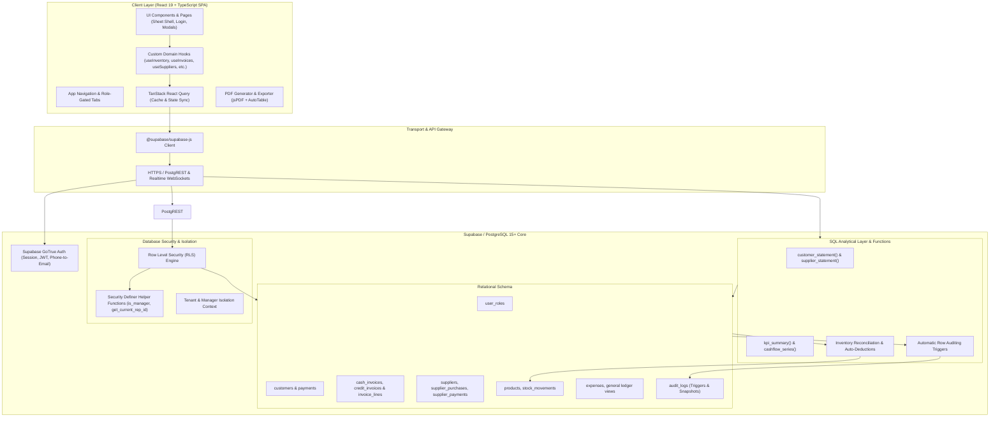
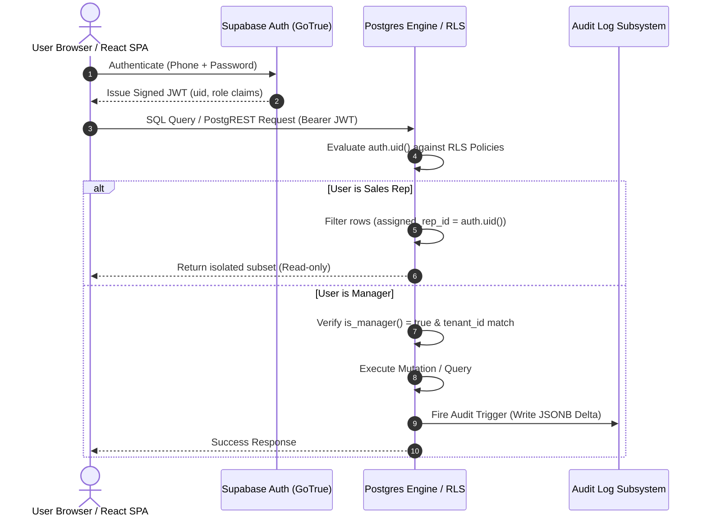

# System Architecture & Technical Specifications

**Project:** Employee Management System (نظام إدارة المبيعات والحسابات والمخزون)  
**Version:** Production-ready Distribution ERP  
**Domain:** FMCG & Food Distribution Business Management  
**Architecture Paradigm:** Client-Server Single-Page Application (SPA) with Backend-as-a-Service (BaaS) & Database-level Security (RLS)

---

## 1. System Overview & Core Philosophy

The Employee Management System is a specialized, multi-role ERP built for distribution and trading businesses. It consolidates operations across sales, warehouse inventory, procurement (accounts payable), customer credit (accounts receivable), operational expenses, and executive financial performance.

### Architectural Tenets
1. **Database as the Single Source of Truth (SSOT) & Security Boundary:**
   - Security and data isolation are not delegated to client-side flags or API route handlers. PostgreSQL Row Level Security (RLS) and `SECURITY DEFINER` functions strictly enforce tenancy and role-based data boundaries directly inside the database engine.
2. **Double-Entry & Cumulative Ledger Accounting:**
   - Monetary figures are not computed on-the-fly via unindexed client loops. Window functions and views compute cumulative running balances (Opening Balance + Debits − Credits) chronologically.
3. **Exact Decimal Precision:**
   - Financial transactions strictly avoid floating-point inaccuracies by using Postgres `numeric(14,2)` and ISO string/BigInt equivalents across serialization layers.
4. **Arabic-First & RTL Ergonomics:**
   - The UI adheres to RTL standards using CSS Logical Properties (`start`, `end`, `ms-*`, `pe-*`), ensuring bilingual alignment (Arabic/English) without layout breakage.

---

## 2. High-Level Architecture Diagram



---

## 3. Technology Stack & Technical Justifications

### 3.1 Frontend Stack

| Technology | Version / Spec | Role & Justification |
|---|---|---|
| **React** | `19.3.x` | Modern reactive UI runtime, leveraging latest concurrent features and standard lifecycle primitives. |
| **TypeScript** | `7.0.x / 5.x+` (Strict) | Compile-time type safety across database entities, query outputs, mutation payloads, and UI props. |
| **Vite** | `8.3.x` | High-performance ES-module build engine with rapid HMR and optimized chunking algorithms for asset delivery. |
| **TanStack React Query** | `5.105.x` | Server-state management: automated background fetching, intelligent caching, cache invalidation tags, and optimistic mutations. |
| **Tailwind CSS** | `3.4.x` | Utility-first CSS framework configured with CSS logical properties (`ps-`, `pe-`, `ms-`, `me-`, `text-start`) for seamless RTL/LTR rendering. |
| **Recharts** | `3.10.x` | SVG-based charting library for financial trend charts, cashflow bar graphs, and receivables aging visualizations. |
| **Lucide React** | `1.62.x` | Vector icon suite optimized with RTL flipping (`rtl:-scale-x-100`) for directional indicators. |
| **jsPDF & AutoTable** | `4.2.x` / `5.0.x` | Pure client-side PDF document generation supporting Arabic font shaping, invoices, catalogs, and account statements. |
| **Oxlint** | `1.89.x` | High-speed static code linter enforcing clean code guidelines and defect prevention. |

### 3.2 Backend & Infrastructure Stack

| Technology | Role & Justification |
|---|---|
| **Supabase BaaS** | Managed infrastructure hosting PostgreSQL, Auth, automated REST (PostgREST), and edge services. |
| **PostgreSQL 15+** | ACID-compliant relational database powering relational schemas, constraints, custom enums, stored procedures, and triggers. |
| **PostgREST** | Automatically generates clean, high-performance RESTful APIs directly from database schemas respecting active JWT claims. |
| **Row Level Security (RLS)** | Kernel-level Postgres security enforcing zero-trust data access policies per user role and manager tenancy. |
| **Vercel** | Edge hosting platform configured with client SPA route fallbacks via `vercel.json`. |

---

## 4. Key Functional Modules & Implementation Details

### 4.1 Multi-Tenant Role-Based Access Control (RBAC)
- **Roles:**
  - `manager`: Full administrative privileges, access to all tabs (Dashboard, Reps, Inventory, Suppliers, Financial statements, Audit logs).
  - `sales_rep`: Constrained scope to their assigned customers and own records. Default access is read-only on the 8 core views plus print/export; managers can grant per-rep view/create/record actions via `reps.permissions` (see `repPermissions.ts` and migration 0034). Inventory and monthly reports are opt-in.
- **Tenant Isolation:**
  - Multi-manager tenancy prevents cross-organization data leakage. Managers can only query, modify, or create records within their tenant boundary.
- **Enforcement:**
  - Evaluated via `public.is_manager()` and `public.get_current_rep_id()` in Postgres functions defined with `SECURITY DEFINER` and a fixed `search_path`. Per-rep feature flags are read by `public.rep_has_permission(key)` inside RLS policies and guarded RPCs; managers always pass.

### 4.2 Cumulative Accounting & Financial Ledger
- **Customer Statement (`customer_statement` RPC):**
  - Evaluates an opening balance before a given date range (`p_from`).
  - Processes debits (invoices) and credits (payments) sequentially.
  - Window functions (`sum(debit - credit) over (order by tx_date, created_at, id)`) calculate exact running balances row-by-row.
- **Supplier Statement (`supplier_statement` RPC):**
  - Accounts payable tracking: Purchases increase balance owed (credit); payments decrease balance (debit).

### 4.3 Real-Time Inventory & Stock Depletion Engine
- **Itemized Invoicing:**
  - Invoices consist of `cash_invoices` / `credit_invoices` (header) and `invoice_lines` (lines with product ID, quantity, unit price, total).
- **Automated Stock Adjustments:**
  - RPCs (`save_cash_invoice`, `save_credit_invoice`) deduct inventory via `stock_movements` upon confirmed invoice sales.
  - Sales returns (`process_sales_return`) reverse stock depletion.
  - Manual adjustments (`adjust_stock`) track breakages, transfers, and incoming supplier restocks.

### 4.4 Automated System Audit Logging
- **`audit_logs` Subsystem:**
  - Captures mutations across critical business tables (`customers`, `invoices`, `supplier_purchases`, `payments`).
  - Logs `operation` (`INSERT`, `UPDATE`, `DELETE`), old/new JSONB row states, actor UID, and client metadata.
  - Filterable by entity, date, actor, and operation type in the `AuditLogsTab`.

### 4.5 Executive Manager KPI Dashboard
- Aggregates operational velocity metrics:
  - **DSO (Days Sales Outstanding):** Measures credit collection velocity.
  - **Income vs. Outcome:** Actual collections vs. supplier payouts & operating expenses.
  - **Receivables Aging Buckets:** `0–30`, `31–60`, `61–90`, and `90+` days overdue.
  - Realized via the `kpi_summary()` Postgres stored function.

---

## 5. Security Architecture & Data Protection



1. **Zero-Trust Client Boundary:** Frontend permission logic only controls navigation display and disables buttons for UX comfort; Postgres RLS blocks unauthorized mutations even if forged via direct HTTP requests.
2. **Prevention of Privilege Escalation:** Role definitions and manager profiles are protected from client mutation triggers; updating roles requires explicit manager authorization through validated functions.
3. **Audit Immutability:** Audit records are write-only via triggers and protected from modification or manual deletion.

---

## 6. Frontend Architectural Patterns & Code Organization

```
src/
├── components/          # Reusable UI & Modal components
│   ├── tabs/            # Feature views (InventoryTab, CashTab, CreditTab, etc.)
│   ├── InvoiceLineEditor.tsx
│   ├── StatementTable.tsx
│   └── FormModal.tsx
├── hooks/               # Encapsulated TanStack Query hooks & business logic
│   ├── useAuth.ts       # Authentication, session state & role helpers
│   ├── useInventory.ts  # Stock levels, movements & depletion hooks
│   ├── useInvoices.ts   # Cash & credit sales mutations
│   └── useKpi.ts        # Executive dashboard analytics
├── lib/                 # Core utilities & integration wrappers
│   ├── supabase.ts      # Singleton Supabase client configuration
│   ├── pdfGenerators.ts # jsPDF report generation engine
│   ├── format.ts        # Currency (EGP) and date localization
│   └── tenant.ts        # Multi-tenant context helpers
├── types/               # Generated & custom TypeScript definitions
│   └── supabase.ts      # Automated schema database types
└── pages/               # Root entry views (Login.tsx, Sheet.tsx)
```

- **Separation of Concerns:** Component tabs handle rendering and presentation; data synchronization, pagination, and caching reside strictly inside isolated custom hooks (`src/hooks/`).
- **Standardized Error Handling:** Global error boundary catches unexpected render crashes, while asynchronous query failures trigger structured contextual toasts.

---

## 7. Deployment & Operational Lifecycle

- **Hosting Environment:** Optimized for Vercel Static Hosting with automated build pipeline (`npm run build`).
- **Database Migrations:** Version-controlled sequential SQL migrations stored under `supabase/migrations/` (from `0001_init.sql` up to `0021_reservations_and_returns.sql`; versions `0004`–`0006` were skipped historically).
- **Type Generation:** Continuous alignment with the database schema through the Supabase CLI (`supabase gen types typescript`).
