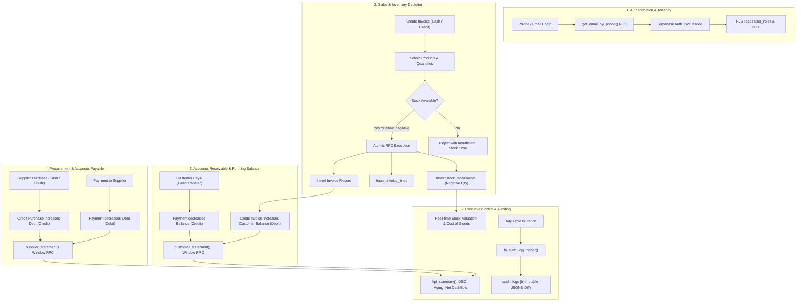
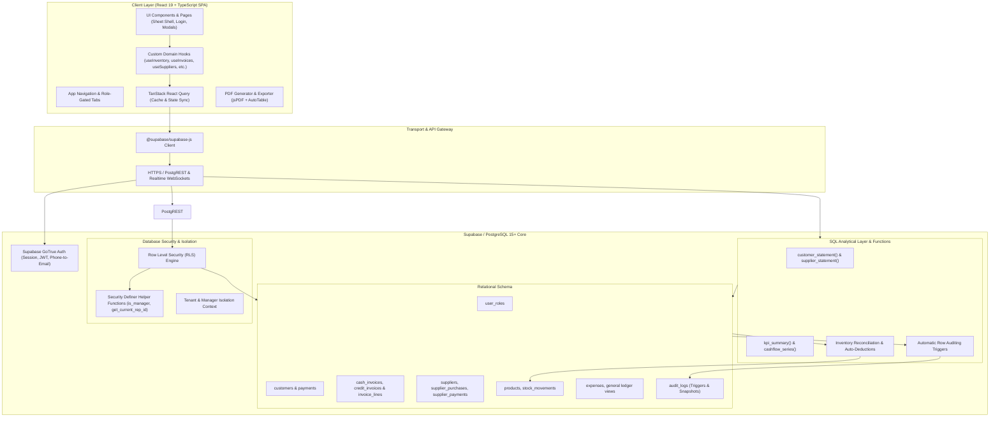
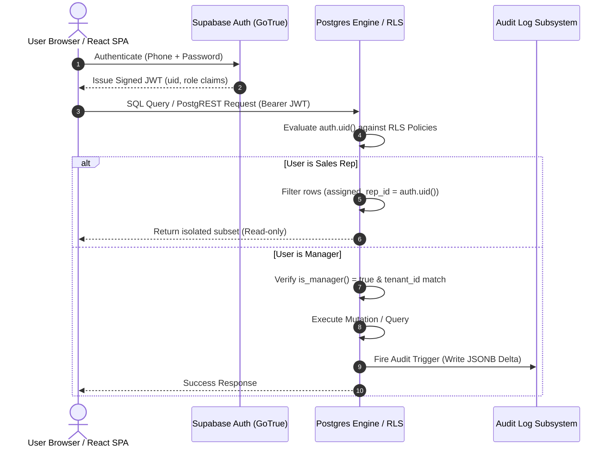

# Consolidated System Documentation (كافة وثائق النظام)

> Single canonical consolidated reference for the **Employee Management System**.
> It is generated from the individual source documents in `docs/` (excluding `README.md` and the root `AGENTS.md` agent brief).
> **Edit the source files, not this snapshot.**

---

## Master Table of Contents

1. [Application Summary, Database Schemas & Architecture](#part-1)
2. [System Architecture & Technical Specifications](#part-2)
3. [User Playbook & Operational Manual](#part-3)
4. [Accounting Model & Specifications](#part-4)
5. [Deployment Guide — Vercel + Supabase](#part-5)
6. [Inventory & Stock Report](#part-6)

---

<a id="part-1"></a>

## 1. Application Summary, Database Schemas & Architecture
> **Source file:** `docs/APP_SUMMARY.md`

---

# Employee Management System — Application Summary, Database Schemas & Architecture

**System Name:** Employee Management System (نظام إدارة المبيعات والحسابات والمخزون)  
**Domain:** FMCG & Wholesale Food Distribution ERP  
**Technology Stack:** React 19, TypeScript, Vite 8, Supabase (PostgreSQL 15+, Auth, RLS, PostgREST), TanStack React Query, Tailwind CSS, Recharts, jsPDF  
**Target Environment:** Vercel Static Hosting + Supabase Managed Cloud  

---

## 1. Executive Summary

The **Employee Management System** is a production-grade, bilingual (Arabic RTL-first with English LTR support) enterprise resource planning (ERP) system tailored for distribution, trading, and wholesale companies.

It replaces fragmented paper ledgers and spreadsheets with a centralized, ACID-compliant database architecture. The system covers:
1. **Multi-Tenant Role-Based Access Control (RBAC):** Strict operational segregation between Managers (full administrative control) and Sales Representatives (strictly scoped read-only access to their assigned customers and catalogs).
2. **Double-Entry & Cumulative Accounting Ledger (كشف حساب تراكمي):** Chronological running-balance calculation for both accounts receivable (customers) and accounts payable (suppliers) using database window functions.
3. **Omni-Channel Invoicing & Cashflow Management:** Immediate cash sales (`cash_invoices`) vs. credit receivables (`credit_invoices`) with automated payment allocations and down payments.
4. **Perpetual Inventory & Stock Depletion Engine:** Itemized multi-line invoices, atomic stock deductions, supplier stock receipts with weighted-average cost (WAC/COGS) valuation, and manual adjustment audits.
5. **Supplier & Procurement Tracking (Accounts Payable):** Tracking vendor profiles, cash/credit purchases, and supplier disbursements.
6. **Executive Financial KPI Dashboard:** Real-time financial velocity metrics including Days Sales Outstanding (DSO), Receivables Aging buckets (0–30, 31–60, 61–90, 90+ days), Cash vs. Credit distributions, and Net Cashflow (Income vs. Outcome).
7. **Automated Immutable Audit Trail:** Database triggers capturing every `INSERT`, `UPDATE`, and `DELETE` event with full JSONB before/after snapshots and actor metadata.
8. **Print & Digital Document Generation:** Clean A4 printable catalog, account statements, invoice printing, and one-click WhatsApp sharing.

---

## 2. Core Architectural Principles

- **Database as the Single Source of Truth (SSOT) & Security Boundary:**
  Security is **never** delegated to frontend UI toggles or client code. PostgreSQL Row Level Security (RLS) policies and `SECURITY DEFINER` stored functions enforce tenancy and role-based permissions at the database engine level. If an unauthorized client attempts a direct PostgREST mutation, the database rejects it.
- **Exact Decimal Arithmetic:**
  All currency fields use PostgreSQL `numeric(14,2)` and inventory quantities use `numeric(14,4)`. Floating-point arithmetic (`float`, `real`, or JavaScript numbers) is strictly prohibited in database schemas to prevent rounding discrepancies in financial statements.
- **Multi-Tenant Manager Isolation:**
  Every core table includes an `owner_id` (foreign key to `auth.users(id)`). Each manager operates an isolated tenant organization; representatives inherit their manager's `owner_id`. Cross-tenant data leaks are physically blocked by RLS.
- **Bilingual RTL-First Ergonomics:**
  Designed natively for Arabic users (`dir="rtl"`) while supporting English (`dir="ltr"`). All UI spacing utilizes CSS logical properties (`ps-*`, `pe-*`, `ms-*`, `me-*`, `text-start`, `text-end`).

---

## 3. User Roles & Access Control Matrix

| Capability / Module | Manager (`manager`) | Sales Representative (`sales_rep`) | Enforcement Mechanism |
|---|---|---|---|
| **Authentication & Profile** | Full access (Phone / Email) | Full access (Phone / Email) | Supabase Auth + `user_roles` |
| **Sales Rep Management** | Create, edit, invite, activate/deactivate reps | Cannot access or view reps | RLS on `reps` + UI gate |
| **Customer Directory** | Full CRUD across entire company | Read-only view of assigned customers | RLS `representative_id = get_current_rep_id()` |
| **Cash Invoices** | Create, view, edit, delete (atomic stock depletion) | Read-only view of assigned invoices | RLS + `save_cash_invoice` RPC |
| **Credit Invoices** | Create, view, edit, delete, allocate payments | Read-only view of assigned credit invoices | RLS + `save_credit_invoice` RPC |
| **Customer Payments** | Record and manage customer payments | Read-only view of assigned payments | RLS on `payments` |
| **Cumulative Customer Statement** | View, export, and print for any customer | View and print for assigned customers only | `customer_statement()` RPC (`security invoker`) |
| **Suppliers & Purchases** | Full CRUD (Purchases, Payments, Statements) | **Forbidden** (Zero access) | RLS policy `public.is_manager()` |
| **Product Catalog & Price List** | Manage products, prices, categories | Read-only view & printable catalog | RLS `public.is_manager()` for DML |
| **Inventory & Stock Management** | Stock receipts, manual adjustments, COGS | View-only stock levels via products | RPCs `receive_stock`, `adjust_stock` |
| **Financial KPI Dashboard** | Full access (DSO, Aging, Income/Outcome) | **Forbidden** (Zero access) | `kpi_summary()` RPC manager check |
| **System Audit Logs** | View full history of tenant mutations | **Forbidden** (Zero access) | RLS policy `public.is_manager()` |

---

## 4. Complete Database Schemas

The database schema is organized into 16 core relational tables, several analytical views, and stored procedure RPCs.

### 4.1 Database Enums & Types
```sql
-- Application Roles
CREATE TYPE public.app_role AS ENUM ('manager', 'sales_rep');

-- Payment & Transaction Classification
CREATE TYPE public.payment_type AS ENUM ('cash', 'credit');
```

---

### 4.2 Relational Tables

#### 1. `user_roles`
Binds Supabase authentication users (`auth.users`) to application roles and tenant owners.
- `user_id` (`uuid`, PK, FK `auth.users.id` ON DELETE CASCADE)
- `role` (`text`, NOT NULL, CHECK: `'manager' | 'sales_rep'`)
- `owner_id` (`uuid`, NOT NULL, FK `auth.users.id` ON DELETE CASCADE) — Tenant administrator ID.
- `created_at` (`timestamptz`, DEFAULT `now()`)

#### 2. `reps`
Directory of sales representatives employed by a manager.
- `id` (`uuid`, PK, DEFAULT `gen_random_uuid()`)
- `owner_id` (`uuid`, NOT NULL, FK `auth.users.id` ON DELETE CASCADE)
- `name` (`text`, NOT NULL)
- `phone` (`text`)
- `email` (`text`) — Used to automatically link with `auth.users` upon signup.
- `user_id` (`uuid`, UNIQUE, FK `auth.users.id` ON DELETE SET NULL)
- `is_active` (`boolean`, DEFAULT `true`)
- `created_at` (`timestamptz`, DEFAULT `now()`)

#### 3. `customers`
Customer directory (accounts receivable clients).
- `id` (`uuid`, PK, DEFAULT `gen_random_uuid()`)
- `owner_id` (`uuid`, NOT NULL, FK `auth.users.id` ON DELETE CASCADE)
- `name` (`text`, NOT NULL)
- `phone` (`text`)
- `representative_id` (`uuid`, FK `reps.id` ON DELETE SET NULL) — Assigned sales representative.
- `opening_balance` (`numeric(14,2)`, DEFAULT `0.00`) — Initial receivable amount owed before system inception.
- `is_active` (`boolean`, DEFAULT `true`)
- `created_at` (`timestamptz`, DEFAULT `now()`)

#### 4. `product_categories`
Classification categories for products.
- `id` (`uuid`, PK, DEFAULT `gen_random_uuid()`)
- `owner_id` (`uuid`, NOT NULL, FK `auth.users.id` ON DELETE CASCADE)
- `name` (`text`, NOT NULL)
- `sort_order` (`integer`, DEFAULT `0`)
- `created_at` (`timestamptz`, DEFAULT `now()`)

#### 5. `products`
Master product catalog and price list.
- `id` (`uuid`, PK, DEFAULT `gen_random_uuid()`)
- `owner_id` (`uuid`, NOT NULL, FK `auth.users.id` ON DELETE CASCADE)
- `name_ar` (`text`, NOT NULL) — Arabic product description.
- `name_en` (`text`) — English product description.
- `sku` (`text`) — Stock keeping unit code.
- `category_id` (`uuid`, FK `product_categories.id` ON DELETE SET NULL)
- `unit` (`text`, DEFAULT `'piece'`) — Packaging unit (carton, kg, piece, etc.).
- `price` (`numeric(14,2)`, NOT NULL, CHECK `>= 0`) — Selling price.
- `is_active` (`boolean`, DEFAULT `true`)
- `sort_order` (`integer`, DEFAULT `0`)
- `updated_at` (`timestamptz`, DEFAULT `now()`)

#### 6. `cash_invoices`
Immediate cash sales invoices.
- `id` (`uuid`, PK, DEFAULT `gen_random_uuid()`)
- `owner_id` (`uuid`, NOT NULL, FK `auth.users.id` ON DELETE CASCADE)
- `invoice_no` (`text`, NOT NULL)
- `date` (`date`, NOT NULL)
- `customer_id` (`uuid`, FK `customers.id` ON DELETE RESTRICT)
- `rep_id` (`uuid`, FK `reps.id` ON DELETE SET NULL)
- `item` (`text`) — Quick summary or notes.
- `amount` (`numeric(14,2)`, NOT NULL, CHECK `>= 0`)
- `notes` (`text`)
- `created_at` (`timestamptz`, DEFAULT `now()`)

#### 7. `credit_invoices`
Deferred payment sales invoices (accounts receivable).
- `id` (`uuid`, PK, DEFAULT `gen_random_uuid()`)
- `owner_id` (`uuid`, NOT NULL, FK `auth.users.id` ON DELETE CASCADE)
- `invoice_no` (`text`, NOT NULL)
- `date` (`date`, NOT NULL)
- `due_date` (`date`, NOT NULL)
- `customer_id` (`uuid`, FK `customers.id` ON DELETE RESTRICT)
- `rep_id` (`uuid`, FK `reps.id` ON DELETE SET NULL)
- `item` (`text`)
- `amount` (`numeric(14,2)`, NOT NULL, CHECK `>= 0`) — Total invoice amount.
- `down_payment` (`numeric(14,2)`, DEFAULT `0.00`) — Initial upfront deposit.
- `remaining_amount` (`numeric(14,2)`, NOT NULL) — Net unpaid balance.
- `status` (`text`, CHECK: `'paid' | 'partial' | 'unpaid'`)
- `notes` (`text`)
- `created_at` (`timestamptz`, DEFAULT `now()`)

#### 8. `invoice_lines`
Itemized line-item details for both cash and credit invoices.
- `id` (`uuid`, PK, DEFAULT `gen_random_uuid()`)
- `owner_id` (`uuid`, NOT NULL, FK `auth.users.id` ON DELETE CASCADE)
- `invoice_type` (`text`, NOT NULL, CHECK: `'cash' | 'credit'`)
- `invoice_id` (`uuid`, NOT NULL) — Polymorphic ID referencing `cash_invoices.id` or `credit_invoices.id`.
- `product_id` (`uuid`, NOT NULL, FK `products.id` ON DELETE RESTRICT)
- `qty` (`numeric(14,4)`, NOT NULL, CHECK `> 0`)
- `unit_price` (`numeric(14,2)`, NOT NULL, CHECK `>= 0`)
- `line_total` (`numeric(14,2)`, GENERATED ALWAYS AS (`qty * unit_price`) STORED)
- `created_at` (`timestamptz`, DEFAULT `now()`)

#### 9. `payments`
Collections and payments received from customers.
- `id` (`uuid`, PK, DEFAULT `gen_random_uuid()`)
- `owner_id` (`uuid`, NOT NULL, FK `auth.users.id` ON DELETE CASCADE)
- `date` (`date`, NOT NULL)
- `customer_id` (`uuid`, NOT NULL, FK `customers.id` ON DELETE RESTRICT)
- `invoice_id` (`uuid`, FK `credit_invoices.id` ON DELETE SET NULL) — Optional allocation to a specific invoice.
- `rep_id` (`uuid`, FK `reps.id` ON DELETE SET NULL)
- `amount` (`numeric(14,2)`, NOT NULL, CHECK `> 0`)
- `method` (`text`, DEFAULT `'cash'`) — Cash, Bank Transfer, Cheque, E-Wallet.
- `reference` (`text`) — Cheque number or transaction reference.
- `notes` (`text`)
- `created_at` (`timestamptz`, DEFAULT `now()`)

#### 10. `stock_movements`
Immutable inventory movement ledger tracking receipts, sales depletions, and manual adjustments.
- `id` (`uuid`, PK, DEFAULT `gen_random_uuid()`)
- `owner_id` (`uuid`, NOT NULL, FK `auth.users.id` ON DELETE CASCADE)
- `product_id` (`uuid`, NOT NULL, FK `products.id` ON DELETE RESTRICT)
- `movement_type` (`text`, NOT NULL, CHECK: `'in' | 'out' | 'adjustment'`)
- `qty` (`numeric(14,4)`, NOT NULL) — Positive for stock intake; negative for sales depletion / loss.
- `unit_cost` (`numeric(14,2)`, DEFAULT `0.00`) — Purchase cost per unit.
- `avg_cost_snapshot` (`numeric(14,2)`) — Weighted average cost at the exact time of the transaction (used for COGS).
- `reference_type` (`text`) — `'cash_invoice' | 'credit_invoice' | 'supplier_purchase' | 'manual' | 'adjustment'`
- `reference_id` (`uuid`) — Linked invoice or purchase ID.
- `notes` (`text`)
- `created_by` (`uuid`, FK `auth.users.id`)
- `created_at` (`timestamptz`, DEFAULT `now()`)

#### 11. `suppliers`
Vendor profiles (accounts payable suppliers).
- `id` (`uuid`, PK, DEFAULT `gen_random_uuid()`)
- `owner_id` (`uuid`, NOT NULL, FK `auth.users.id` ON DELETE CASCADE)
- `name` (`text`, NOT NULL)
- `phone` (`text`)
- `address` (`text`)
- `tax_number` (`text`)
- `notes` (`text`)
- `opening_balance` (`numeric(14,2)`, DEFAULT `0.00`) — Initial balance owed to supplier before system startup.
- `is_active` (`boolean`, DEFAULT `true`)
- `created_at` (`timestamptz`, DEFAULT `now()`)

#### 12. `supplier_purchases`
Purchases acquired from suppliers (Cash or Credit).
- `id` (`uuid`, PK, DEFAULT `gen_random_uuid()`)
- `owner_id` (`uuid`, NOT NULL, FK `auth.users.id` ON DELETE CASCADE)
- `supplier_id` (`uuid`, NOT NULL, FK `suppliers.id` ON DELETE RESTRICT)
- `purchase_date` (`date`, NOT NULL)
- `invoice_no` (`text`) — Supplier's physical invoice number.
- `payment_type` (`text`, NOT NULL, CHECK: `'cash' | 'credit'`)
- `total_amount` (`numeric(14,2)`, NOT NULL, CHECK `>= 0`)
- `notes` (`text`)
- `created_by` (`uuid`, FK `auth.users.id`)
- `created_at` (`timestamptz`, DEFAULT `now()`)

Purchases are saved through the `save_supplier_purchase` RPC together with their product lines. The RPC creates the linked `stock_movements` (reference type `supplier_purchase`) and derives `total_amount` from the lines, so a purchase is recorded once instead of separately as a manual stock receipt. On edit, the current version's movements are archived (`supplier_purchase_history`) and reversed before the new ones are written; this makes repeated edits safe. Deleting archives and reverses the current version's movements and is blocked if it would drive stock negative; a repeated delete is a no-op. The RPCs are executable only by `authenticated` managers. Legacy purchases without lines are left untouched until edited, and the edit modal requires explicit acknowledgement before it adds stock for them.

#### 12a. `supplier_purchase_lines`
Line items of a supplier purchase (created by migration 0026).
- `id` (`uuid`, PK, DEFAULT `gen_random_uuid()`)
- `owner_id` (`uuid`, NOT NULL, FK `auth.users.id`, DEFAULT `current_owner_id()`)
- `purchase_id` (`uuid`, NOT NULL, FK `supplier_purchases.id` ON DELETE CASCADE)
- `product_id` (`uuid`, NOT NULL, FK `products.id` ON DELETE RESTRICT)
- `qty` (`numeric(14,4)`, NOT NULL, CHECK `> 0`)
- `unit_cost` (`numeric(14,2)`, NOT NULL, CHECK `>= 0`)
- `line_total` (`numeric(14,2)`, GENERATED ALWAYS AS `qty * unit_cost` STORED)
- `expiry_date` (`date`), `batch_number` (`text`)
- `created_at` (`timestamptz`, DEFAULT `now()`)
RLS: manager read-only on the table; all writes go through the security-definer RPCs.

#### 13. `supplier_payments`
Disbursements made to suppliers.
- `id` (`uuid`, PK, DEFAULT `gen_random_uuid()`)
- `owner_id` (`uuid`, NOT NULL, FK `auth.users.id` ON DELETE CASCADE)
- `supplier_id` (`uuid`, NOT NULL, FK `suppliers.id` ON DELETE RESTRICT)
- `payment_date` (`date`, NOT NULL)
- `amount` (`numeric(14,2)`, NOT NULL, CHECK `> 0`)
- `method` (`text`, DEFAULT `'cash'`)
- `reference` (`text`)
- `notes` (`text`)
- `purchase_id` (`uuid`, FK `supplier_purchases.id` ON DELETE SET NULL)
- `created_by` (`uuid`, FK `auth.users.id`)
- `created_at` (`timestamptz`, DEFAULT `now()`)

#### 14. `expenses`
Operational overhead expenses (salaries, fuel, rent, utility bills).
- `id` (`uuid`, PK, DEFAULT `gen_random_uuid()`)
- `owner_id` (`uuid`, NOT NULL, FK `auth.users.id` ON DELETE CASCADE)
- `expense_date` (`date`, NOT NULL)
- `category` (`text`, NOT NULL)
- `amount` (`numeric(14,2)`, NOT NULL, CHECK `> 0`)
- `description` (`text`)
- `created_by` (`uuid`, FK `auth.users.id`)
- `created_at` (`timestamptz`, DEFAULT `now()`)

#### 15. `app_settings`
Tenant-level configuration parameters.
- `id` (`uuid`, PK, DEFAULT `gen_random_uuid()`)
- `owner_id` (`uuid`, UNIQUE, NOT NULL, FK `auth.users.id` ON DELETE CASCADE)
- `title` (`text`, DEFAULT `'نظام إدارة المبيعات والحسابات'`)
- `tab_names` (`jsonb`, DEFAULT `'{}'`) — Custom names for tabs.
- `allow_negative_stock` (`boolean`, DEFAULT `false`) — Whether invoices can be posted when warehouse quantity is insufficient.
- `updated_at` (`timestamptz`, DEFAULT `now()`)

#### 16. `audit_logs`
Immutable system audit record tracking data changes across all tables.
- `id` (`uuid`, PK, DEFAULT `gen_random_uuid()`)
- `owner_id` (`uuid`, NOT NULL, FK `auth.users.id` ON DELETE CASCADE)
- `actor_id` (`uuid`, FK `auth.users.id` ON DELETE SET NULL)
- `actor_email` (`text`)
- `actor_name` (`text`)
- `actor_role` (`text`)
- `table_name` (`text`, NOT NULL)
- `record_id` (`text`, NOT NULL)
- `action` (`text`, NOT NULL, CHECK: `'INSERT' | 'UPDATE' | 'DELETE'`)
- `old_data` (`jsonb`)
- `new_data` (`jsonb`)
- `changed_fields` (`text[]`)
- `description` (`text`)
- `created_at` (`timestamptz`, DEFAULT `now()`)

---

### 4.3 Analytical Views & Stored Procedures (RPCs)

#### Analytical Views
- **`v_credit_invoices`:** Calculates total payments applied to each credit invoice, computed remaining balance, and dynamically updates status (`paid`, `partial`, `unpaid`).
- **`v_customer_transactions`:** Unified chronological ledger view combining credit invoices (Debits) and customer payments (Credits).
- **`v_supplier_transactions`:** Unified chronological ledger view combining supplier credit purchases (Credits) and payments to suppliers (Debits).
- **`v_product_stock` / `product_stock_summary`:** Real-time stock calculation per product aggregating `total_in`, `total_out`, `current_stock`, and weighted average cost.
- **`stock_movement_history`:** Chronological stock audit table showing item description, movement delta, unit cost, and reference document.
- **`stock_valuation`:** Multiplies current physical stock by weighted average cost to provide real-time inventory asset valuation.

#### Core Stored Procedures (RPCs)
- **`customer_statement(p_customer_id, p_from, p_to)` (`SECURITY INVOKER`):**
  Calculates cumulative customer balance. Computes opening balance before `p_from`, then applies window functions over all transactions in the date range:
  $$\text{Running Balance} = \text{Opening Balance} + \sum (\text{Debit} - \text{Credit})$$
- **`supplier_statement(p_supplier_id, p_from, p_to)` (`SECURITY INVOKER`):**
  Calculates cumulative supplier balance (Accounts Payable):
  $$\text{Supplier Running Balance} = \text{Opening Balance} + \sum (\text{Credit} - \text{Debit})$$
- **`kpi_summary(p_from, p_to)` (`SECURITY DEFINER`):**
  Manager-only analytical aggregation. Computes total income (cash invoices + customer payments), outcome (supplier payments + cash purchases + expenses), cash vs. credit breakdown, outstanding receivables, accounts payable, Days Sales Outstanding (DSO), average collection velocity, and 30-day collection rate.
- **`cashflow_series(p_from, p_to, p_bucket)` (`SECURITY DEFINER`):**
  Groups cash inflows and outflows by day or week for Recharts bar charts.
- **`receivables_aging(p_as_of)` (`SECURITY DEFINER`):**
  Categorizes unpaid customer credit invoices into aging buckets: `0–30 days`, `31–60 days`, `61–90 days`, and `90+ days`.
- **`save_cash_invoice(...)` & `save_credit_invoice(...)` (`SECURITY DEFINER`):**
  Atomic transaction wrappers that validate stock availability (checking `allow_negative_stock`), insert the invoice header, insert line items into `invoice_lines`, and record negative stock movements in `stock_movements`.
- **`delete_cash_invoice(...)` & `delete_credit_invoice(...)` (`SECURITY DEFINER`):**
  Safely cancels an invoice, deletes line items, and inserts reverse stock adjustments to return goods to warehouse inventory.
- **`receive_stock(...)` & `adjust_stock(...)` (`SECURITY DEFINER`):**
  Updates warehouse stock on incoming shipments (calculating new weighted average unit cost) or records physical stock audit adjustments.
- **`get_email_by_phone(phone_input)` (`SECURITY DEFINER`):**
  Resolves Egyptian phone numbers (+20) to internal Supabase Auth emails for password authentication.

---

## 5. How It Works: End-to-End Operational Workflows



### 5.1 Authentication & Phone-First Login Workflow
1. The user inputs their Egyptian phone number (e.g., `01012345678` or `+2010...`) and password.
2. The client invokes `supabase.rpc('get_email_by_phone', { phone_input })`, resolving the internal email format `2010...@phone.app`.
3. Supabase Auth validates credentials and returns a cryptographically signed JWT.
4. On initialization, `useAuth` queries `current_role_name()`, `current_owner_id()`, and `get_current_rep_id()`.
5. If the user is unconfirmed or has no assigned role, access is immediately blocked.

### 5.2 Invoicing & Perpetual Inventory Depletion
1. Manager enters an invoice with multiple products using `InvoiceLineEditor`.
2. The client calls the atomic stored procedure `save_cash_invoice` or `save_credit_invoice`.
3. The database procedure:
   - Verifies whether `allow_negative_stock` is enabled in `app_settings`.
   - Checks available stock in `v_product_stock` against line item quantities.
   - Snapshots the current weighted average cost (`avg_cost_snapshot`) for COGS tracking.
   - Inserts the invoice header and child line items (`invoice_lines`).
   - Inserts corresponding negative stock records into `stock_movements`.
   - Returns the created invoice with its assigned number.

### 5.3 Accounts Receivable & Cumulative Customer Ledger
- **Debit Entry (مدين):** Credit invoices increase the amount owed by the customer.
- **Credit Entry (دائن):** Down payments, cash payments, bank transfers, and cheques decrease the customer's balance.
- **Cumulative Running Balance:** When querying `customer_statement`, the database:
  1. Computes the opening balance as:
     $$\text{Opening} = \text{Initial Customer Balance} + \sum_{\text{date} < p\_from} (\text{Debits} - \text{Credits})$$
  2. Traverses all transactions between `p_from` and `p_to` ordered chronologically (`tx_date`, `created_at`, `id`).
  3. Calculates the running balance row-by-row using `SUM(debit - credit) OVER (...)`.

### 5.4 Accounts Payable & Supplier Accounting
- **Credit Purchase:** Increases accounts payable owed to the vendor (Credit).
- **Payment to Supplier:** Decreases accounts payable owed to the vendor (Debit).
- **Cash Purchase:** Handled as an immediate operational outflow in cashflow KPI metrics, netting to zero on the supplier's credit ledger.

### 5.5 Warehouse Replenishment & Weighted Average Costing
- When shipments arrive, the manager records a stock receipt via `receive_stock(p_product_id, p_qty, p_unit_cost, ...)`.
- The system recalculates the moving weighted average cost:
  $$\text{New WAC} = \frac{(\text{Current Qty} \times \text{Current WAC}) + (\text{Received Qty} \times \text{Received Cost})}{\text{Current Qty} + \text{Received Qty}}$$
- Real-time stock valuation is automatically updated across the inventory tab.

### 5.6 Executive Financial KPI Metrics
- **Income:** Total cash collected = $\text{Cash Invoices} + \text{Customer Payments}$.
- **Outcome:** Total cash spent = $\text{Supplier Payments} + \text{Cash Purchases} + \text{Operating Expenses}$.
- **Net Cashflow:** $\text{Income} - \text{Outcome}$.
- **DSO (Days Sales Outstanding):**
  $$\text{DSO} = \frac{\text{Total Unpaid Receivables}}{\text{Total Credit Sales in Period}} \times \text{Days in Period}$$
- **Receivables Aging:** Categorizes credit balances into 30-day cohorts to identify overdue credit risk.

### 5.7 Automated System Auditing
- A PostgreSQL `AFTER INSERT OR UPDATE OR DELETE` trigger (`fn_audit_log_trigger`) monitors 13 critical tables.
- Changes capture the actor ID, email, role, table name, affected record ID, old JSONB record, new JSONB record, and an array of changed fields.
- Audit records are append-only; direct deletion or editing is prevented by RLS.

---

## 6. Frontend Architecture & Directory Layout

```
src/
├── components/                  # Presentation & Modal components
│   ├── tabs/                    # Primary tab navigation screens
│   │   ├── ManagerDashboardTab.tsx # Executive KPI dashboard & charts
│   │   ├── CashTab.tsx          # Immediate cash sales & itemized lines
│   │   ├── CreditTab.tsx        # Credit sales, payment allocations & aging
│   │   ├── PaymentsTab.tsx      # Customer collections
│   │   ├── CustomersTab.tsx     # Customer directory & statement links
│   │   ├── SuppliersTab.tsx     # Supplier directory, purchases & payables
│   │   ├── InventoryTab.tsx     # Stock balances, valuation & movements
│   │   ├── ProductsTab.tsx      # Product catalog & printable price list
│   │   ├── ExpensesTab.tsx      # Operational expenses
│   │   ├── RepsTab.tsx          # Sales representative administration
│   │   ├── AuditLogsTab.tsx     # Audit trail viewer & diff inspector
│   │   └── MonthlyTab.tsx       # Periodical summary statements
│   ├── AppNavigation.tsx        # Responsive header, tab switcher & role indicators
│   ├── InvoiceLineEditor.tsx    # Multi-product line editor with autocomplete
│   ├── StatementTable.tsx       # Shared cumulative statement table (RTL/LTR)
│   ├── WhatsAppShareButton.tsx  # Generates direct WhatsApp shareable statements
│   └── FormModal.tsx            # Standardized accessible modal container
├── hooks/                       # Domain logic & TanStack React Query hooks
│   ├── useAuth.ts               # Session management & role checks
│   ├── useInventory.ts          # Stock queries, receipts & adjustments
│   ├── useInvoices.ts           # Cash and credit invoice mutations
│   ├── useSuppliers.ts          # Accounts payable data fetching
│   ├── useKpi.ts                # Manager dashboard metrics & cashflow series
│   └── useAuditLogs.ts          # Audit trail queries & filters
├── lib/                         # Core libraries & singleton services
│   ├── supabase.ts              # Supabase JavaScript client instance
│   ├── pdfGenerators.ts         # jsPDF document generator with Arabic font support
│   └── format.ts                # Currency (EGP) and date formatters
├── types/                       # TypeScript interfaces & Supabase definitions
│   └── supabase.ts              # Auto-generated database schema types
└── pages/                       # Root views
    ├── Login.tsx                # Phone/Email login & password recovery form
    └── Sheet.tsx                # Authenticated application shell & tab router
```

---

## 7. Verification & Operational Health Check

- **Type Safety:** Verified using `npm run typecheck` (`tsc -b`), ensuring zero type mismatches with Supabase generated types.
- **Linting & Code Quality:** Verified using `npm run lint` (`oxlint`).
- **Production Bundle:** Verified via `npm run build` producing optimized chunks in `dist/`.

---

<a id="part-2"></a>

## 2. System Architecture & Technical Specifications
> **Source file:** `docs/SYSTEM_ARCHITECTURE.md`

---

# System Architecture & Technical Specifications

**Project:** Employee Management System (نظام إدارة المبيعات والحسابات والمخزون)  
**Version:** Production-ready Distribution ERP  
**Domain:** FMCG & Food Distribution Business Management  
**Architecture Paradigm:** Client-Server Single-Page Application (SPA) with Backend-as-a-Service (BaaS) & Database-level Security (RLS)

---

## 1. System Overview & Core Philosophy

The Employee Management System is a specialized, multi-role ERP built for distribution and trading businesses. It consolidates operations across sales, warehouse inventory, procurement (accounts payable), customer credit (accounts receivable), operational expenses, and executive financial performance.

### Architectural Tenets
1. **Database as the Single Source of Truth (SSOT) & Security Boundary:**
   - Security and data isolation are not delegated to client-side flags or API route handlers. PostgreSQL Row Level Security (RLS) and `SECURITY DEFINER` functions strictly enforce tenancy and role-based data boundaries directly inside the database engine.
2. **Double-Entry & Cumulative Ledger Accounting:**
   - Monetary figures are not computed on-the-fly via unindexed client loops. Window functions and views compute cumulative running balances (Opening Balance + Debits − Credits) chronologically.
3. **Exact Decimal Precision:**
   - Financial transactions strictly avoid floating-point inaccuracies by using Postgres `numeric(14,2)` and ISO string/BigInt equivalents across serialization layers.
4. **Arabic-First & RTL Ergonomics:**
   - The UI adheres to RTL standards using CSS Logical Properties (`start`, `end`, `ms-*`, `pe-*`), ensuring bilingual alignment (Arabic/English) without layout breakage.

---

## 2. High-Level Architecture Diagram



---

## 3. Technology Stack & Technical Justifications

### 3.1 Frontend Stack

| Technology | Version / Spec | Role & Justification |
|---|---|---|
| **React** | `19.3.x` | Modern reactive UI runtime, leveraging latest concurrent features and standard lifecycle primitives. |
| **TypeScript** | `7.0.x / 5.x+` (Strict) | Compile-time type safety across database entities, query outputs, mutation payloads, and UI props. |
| **Vite** | `8.3.x` | High-performance ES-module build engine with rapid HMR and optimized chunking algorithms for asset delivery. |
| **TanStack React Query** | `5.105.x` | Server-state management: automated background fetching, intelligent caching, cache invalidation tags, and optimistic mutations. |
| **Tailwind CSS** | `3.4.x` | Utility-first CSS framework configured with CSS logical properties (`ps-`, `pe-`, `ms-`, `me-`, `text-start`) for seamless RTL/LTR rendering. |
| **Recharts** | `3.10.x` | SVG-based charting library for financial trend charts, cashflow bar graphs, and receivables aging visualizations. |
| **Lucide React** | `1.62.x` | Vector icon suite optimized with RTL flipping (`rtl:-scale-x-100`) for directional indicators. |
| **jsPDF & AutoTable** | `4.2.x` / `5.0.x` | Pure client-side PDF document generation supporting Arabic font shaping, invoices, catalogs, and account statements. |
| **Oxlint** | `1.89.x` | High-speed static code linter enforcing clean code guidelines and defect prevention. |

### 3.2 Backend & Infrastructure Stack

| Technology | Role & Justification |
|---|---|
| **Supabase BaaS** | Managed infrastructure hosting PostgreSQL, Auth, automated REST (PostgREST), and edge services. |
| **PostgreSQL 15+** | ACID-compliant relational database powering relational schemas, constraints, custom enums, stored procedures, and triggers. |
| **PostgREST** | Automatically generates clean, high-performance RESTful APIs directly from database schemas respecting active JWT claims. |
| **Row Level Security (RLS)** | Kernel-level Postgres security enforcing zero-trust data access policies per user role and manager tenancy. |
| **Vercel** | Edge hosting platform configured with client SPA route fallbacks via `vercel.json`. |

---

## 4. Key Functional Modules & Implementation Details

### 4.1 Multi-Tenant Role-Based Access Control (RBAC)
- **Roles:**
  - `manager`: Full administrative privileges, access to all tabs (Dashboard, Reps, Inventory, Suppliers, Financial statements, Audit logs).
  - `sales_rep`: Constrained scope. Can view only their assigned customers, invoices, and credit transactions in read-only mode; can view the product catalog.
- **Tenant Isolation:**
  - Multi-manager tenancy prevents cross-organization data leakage. Managers can only query, modify, or create records within their tenant boundary.
- **Enforcement:**
  - Evaluated via `public.is_manager()` and `public.get_current_rep_id()` in Postgres functions defined with `SECURITY DEFINER` and a fixed `search_path`.

### 4.2 Cumulative Accounting & Financial Ledger
- **Customer Statement (`customer_statement` RPC):**
  - Evaluates an opening balance before a given date range (`p_from`).
  - Processes debits (invoices) and credits (payments) sequentially.
  - Window functions (`sum(debit - credit) over (order by tx_date, created_at, id)`) calculate exact running balances row-by-row.
- **Supplier Statement (`supplier_statement` RPC):**
  - Accounts payable tracking: Purchases increase balance owed (credit); payments decrease balance (debit).

### 4.3 Real-Time Inventory & Stock Depletion Engine
- **Itemized Invoicing:**
  - Invoices consist of `cash_invoices` / `credit_invoices` (header) and `invoice_lines` (lines with product ID, quantity, unit price, total).
- **Automated Stock Adjustments:**
  - RPCs (`save_cash_invoice`, `save_credit_invoice`) deduct inventory via `stock_movements` upon confirmed invoice sales.
  - Sales returns (`process_sales_return`) reverse stock depletion.
  - Manual adjustments (`adjust_stock`) track breakages, transfers, and incoming supplier restocks.

### 4.4 Automated System Audit Logging
- **`audit_logs` Subsystem:**
  - Captures mutations across critical business tables (`customers`, `invoices`, `supplier_purchases`, `payments`).
  - Logs `operation` (`INSERT`, `UPDATE`, `DELETE`), old/new JSONB row states, actor UID, and client metadata.
  - Filterable by entity, date, actor, and operation type in the `AuditLogsTab`.

### 4.5 Executive Manager KPI Dashboard
- Aggregates operational velocity metrics:
  - **DSO (Days Sales Outstanding):** Measures credit collection velocity.
  - **Income vs. Outcome:** Actual collections vs. supplier payouts & operating expenses.
  - **Receivables Aging Buckets:** `0–30`, `31–60`, `61–90`, and `90+` days overdue.
  - Realized via the `kpi_summary()` Postgres stored function.

---

## 5. Security Architecture & Data Protection



1. **Zero-Trust Client Boundary:** Frontend permission logic only controls navigation display and disables buttons for UX comfort; Postgres RLS blocks unauthorized mutations even if forged via direct HTTP requests.
2. **Prevention of Privilege Escalation:** Role definitions and manager profiles are protected from client mutation triggers; updating roles requires explicit manager authorization through validated functions.
3. **Audit Immutability:** Audit records are write-only via triggers and protected from modification or manual deletion.

---

## 6. Frontend Architectural Patterns & Code Organization

```
src/
├── components/          # Reusable UI & Modal components
│   ├── tabs/            # Feature views (InventoryTab, CashTab, CreditTab, etc.)
│   ├── InvoiceLineEditor.tsx
│   ├── StatementTable.tsx
│   └── FormModal.tsx
├── hooks/               # Encapsulated TanStack Query hooks & business logic
│   ├── useAuth.ts       # Authentication, session state & role helpers
│   ├── useInventory.ts  # Stock levels, movements & depletion hooks
│   ├── useInvoices.ts   # Cash & credit sales mutations
│   └── useKpi.ts        # Executive dashboard analytics
├── lib/                 # Core utilities & integration wrappers
│   ├── supabase.ts      # Singleton Supabase client configuration
│   ├── pdfGenerators.ts # jsPDF report generation engine
│   ├── format.ts        # Currency (EGP) and date localization
│   └── tenant.ts        # Multi-tenant context helpers
├── types/               # Generated & custom TypeScript definitions
│   └── supabase.ts      # Automated schema database types
└── pages/               # Root entry views (Login.tsx, Sheet.tsx)
```

- **Separation of Concerns:** Component tabs handle rendering and presentation; data synchronization, pagination, and caching reside strictly inside isolated custom hooks (`src/hooks/`).
- **Standardized Error Handling:** Global error boundary catches unexpected render crashes, while asynchronous query failures trigger structured contextual toasts.

---

## 7. Deployment & Operational Lifecycle

- **Hosting Environment:** Optimized for Vercel Static Hosting with automated build pipeline (`npm run build`).
- **Database Migrations:** Version-controlled sequential SQL migrations stored under `supabase/migrations/` (from `0001_init.sql` up to `0021_reservations_and_returns.sql`; versions `0004`–`0006` were skipped historically).
- **Type Generation:** Continuous alignment with the database schema through the Supabase CLI (`supabase gen types typescript`).

---

<a id="part-3"></a>

## 3. User Playbook & Operational Manual
> **Source file:** `docs/Playbook.md`

---

# Sales Management & Accounting System: User Playbook

Welcome to the complete user guide for the sales distribution and financial accounting system. It is built for distribution companies and trading businesses, and gives you precise control over sales, supplier tracking, cumulative account statements, and financial performance indicators.

---

## Table of Contents
1. [Roles and Access Control (RBAC)](#1-roles-and-access-control-rbac)
2. [Signing In and Setting Up Sales Reps](#2-signing-in-and-setting-up-sales-reps)
3. [Managing Customers and Sales (Cash and Credit)](#3-managing-customers-and-sales-cash-and-credit)
4. [Cumulative Account Statements (Customer Statement)](#4-cumulative-account-statements-customer-statement)
5. [Managing Suppliers and Purchases (Accounts Payable)](#5-managing-suppliers-and-purchases-accounts-payable)
6. [Price List and Printable Product Catalog](#6-price-list-and-printable-product-catalog)
7. [Manager Financial KPI Dashboard](#7-manager-financial-kpi-dashboard)
8. [Reports, Data Export, and Printing](#8-reports-data-export-and-printing)

---

## 1. Roles and Access Control (RBAC)

The system has two types of users.

### A. Manager (Admin)
- **Access**: Full, unrestricted access to every function in the system.
- **Manager-only tasks**:
  - Add, edit, and delete sales reps, and invite them by email.
  - Manage suppliers, purchase invoices, and supplier payments.
  - View the financial KPI dashboard, receivables aging, and cash liquidity.
  - Add and edit product prices in the catalog.
  - Filter and browse any rep's data, or view company-wide totals.

### B. Sales Rep
- **Access**: **Read-only**, strictly enforced at the database level.
- **Scope**:
  - Sees **only** the customers assigned to them, along with those customers' invoices and payments.
  - Cannot edit, delete, or add customer records or financial records.
  - Can view and print the approved price list (catalog) for use during field visits.
  - Cannot access the Suppliers tab or the manager's financial dashboard.

---

## 2. Signing In and Setting Up Sales Reps

### Signing In
1. Open the system in your browser at `http://localhost:5173` (or your deployment URL).
2. Enter your registered phone number and password (phone-first login; an email alias also works).
3. The system automatically verifies your role:
   - If the account belongs to a registered sales rep, Sales Rep mode is activated and a badge appears: `Sales Rep: [Name] (View Only)`.
   - If the account belongs to the owner, you enter in Manager mode with full permissions.

### Managing and Inviting Sales Reps (Manager Only)
1. At the top of the home page, find the **Sales Rep Management & Invitations** bar.
2. Click **+ Add New Sales Rep**.
3. Enter:
   - **Rep name** (e.g., Ahmed Mostafa).
   - **Rep email address** (important: this links their account when they sign in).
   - **Phone number**.
4. When the rep creates an account with the same email address, it is linked automatically and their permissions are restricted accordingly.

---

## 3. Managing Customers and Sales (Cash and Credit)

### A. Customer Directory (Customers Tab)
- **Add a customer**: Click **+ New Customer**, enter the customer's name and phone number, and select the responsible sales rep.
- **Edit / delete**: Available to managers only, using the action buttons next to each customer.
- **Cumulative statement**: Click **Statement** to open the customer's live cumulative account record.

### B. Cash Sales (Cash Tab)
- Use this tab to record invoices paid in full at the time of sale, with no outstanding balance.
- Enter the invoice number, invoice date, customer name, sales rep, description, and amount.

### C. Credit Sales (Credit Tab)
- Use this tab to record credit invoices that increase the customer's outstanding balance.
- Enter the invoice number, customer, sales rep, total amount, due date, and any down payment.
- The remaining balance and invoice status (`Unpaid`, `Partial`, `Paid`) are tracked automatically.

### D. Customer Payments (Payments Tab)
- Use this tab to record payments received from customers against credit invoices or on account.
- Select the customer, sales rep, linked invoice, amount paid, and payment method (`Cash`, `Bank Transfer`, `Cheque`, `E-Wallet`).

---

## 4. Cumulative Account Statements (Customer Statement)

The cumulative statement follows standard accounting principles:
- **Debit (+)**: Credit invoices, which increase the customer's balance owed to the company.
- **Credit (−)**: Payments received and down payments, which reduce that balance.
- **Opening balance**: When you select a date range (from – to), the system calculates the customer's net balance before the start date and shows it as the first row.
- **Running balance**: Calculated row by row in chronological order.
- **Export and print**: Print the statement directly, or export it to **Excel (CSV)** with one click.

---

## 5. Managing Suppliers and Purchases (Accounts Payable)

The **Suppliers & Purchases** tab (manager only) has four main sections.

### A. Supplier Directory
- Record supplier details: name, phone, address, tax number, and an opening balance if applicable.
- Each supplier shows their current balance and a direct button to their statement.

### B. Purchase Invoice Log
- Click **+ Record Purchase Invoice**.
- Select the supplier, enter the invoice number, and set the purchase date.
- **Purchase method**:
  - **Credit**: Increases the amount owed to the supplier and appears in the statement and liabilities.
  - **Cash**: Paid immediately and counted as a cash outflow.

### C. Supplier Payments
- Click **+ Pay Supplier**.
- Select the supplier, enter the amount, choose the payment method (`Cash`, `Cheque`, `Bank Transfer`), and add a reference or cheque number.
- The payment is deducted from the supplier's balance immediately.

### D. Cumulative Supplier Statement
- Select a supplier to view their transactions (purchases and payments) with a continuous running balance.

---

## 6. Price List and Printable Product Catalog

The **Price List & Catalog** tab provides a central product database.
- **Add a product**: Arabic name, English name, product code (SKU), category, unit, and selling price.
- **Search and filter**: Search quickly, or filter by category.
- **Field printing (A4)**:
  - Click **Print Price List (A4)**.
  - The page formats itself to A4 and hides all app buttons and navigation bars, so reps can print it and hand it to customers.

---

## 7. Manager Financial KPI Dashboard

The **Financial KPIs** tab is reserved for managers and gives a strategic view of liquidity and collections.

1. **Income vs. Outcome**:
   - **Total income**: Cash actually collected from sales and payments.
   - **Total outcome**: Supplier payments, cash purchases, and expenses.
   - **Net cash flow**: The liquidity surplus or deficit for the period.
2. **Days Sales Outstanding (DSO)**:
   - The estimated number of days it takes to collect credit sales.
3. **Receivables Aging**:
   - A chart that groups customer debts into `0–30 days`, `31–60 days`, `61–90 days`, and `90+ days`, so overdue balances stand out quickly.
4. **Collection and Liquidity Ratios**:
   - Cash sales vs. credit sales as a percentage.
   - Cash collected vs. customer receivables and supplier liabilities.

---

## 8. Reports, Data Export, and Printing

- **CSV export**: Available on account statements and the home page, for opening in tools such as Microsoft Excel.
- **Printing**: Every screen and statement is formatted for clean, uncluttered printing.
- **Language support (RTL)**: The interface fully supports Arabic right-to-left layout, with accurately aligned accounting figures.

---

<a id="part-4"></a>

## 4. Accounting Model & Specifications
> **Source file:** `docs/accounting-model.md`

---

# Accounting Model & Specifications

## 1. Role-Based Access Control (RBAC)

### Roles & Security Model
- **Manager (`manager`)**:
  - Full CRUD permissions across all system tables (`customers`, `cash_invoices`, `credit_invoices`, `payments`, `suppliers`, `supplier_purchases`, `supplier_payments`, `products`, `expenses`).
  - Access to team management, representative assignment, executive KPI dashboard, and supplier accounting.
- **Sales Rep (`sales_rep`)**:
  - Strict read-only access enforced at both Database RLS and Frontend levels.
  - Can only query their own assigned customers and related invoices/payments.
  - Can view and print the Product Price List.
   - No access to Suppliers, operational expenses, or Manager Financial KPIs.

### Enforcement Details (migration `0014_rbac_hardening_v2`)
- **Database is the boundary.** Reps hold only `select` policies; every write on customers, invoices, payments, suppliers, products and expenses is rejected at the DB (0 rows affected or RLS error), regardless of the UI.
- **Confirmation gate.** `current_role_name()` / `current_owner_id()` return `null` until `auth.users.email_confirmed_at` is set, so an unconfirmed account has no role and sees no rows (products included). The UI shows the «لا تملك صلاحية الوصول» screen in that case.
- **Provisioning is centralised.** `public.provision_user_role(uuid)` (SECURITY DEFINER, execute revoked from `public`/`anon`/`authenticated`) is the only role-granting path. It runs from `handle_new_user()` on signup and `handle_user_email_confirmed()` when confirmation arrives.
- **Role escalation is impossible from the client.** `user_roles` has RLS with no client-facing policy and no table grant; a rep cannot promote itself. `sync_rep_role` never demotes a manager and never moves a role across owners.
- **Rep identity is bound to one row.** `uq_reps_user_id` (partial unique index) guarantees one rep row per user, so `get_current_rep_id()` is unambiguous.
- **Rep visibility rule.** A rep sees a customer when `representative_id = get_current_rep_id()`, and sees an invoice/payment when it carries their `rep_id` or belongs to one of their customers. There is no cross-rep visibility.
- **Search path hardening.** Every `public` SECURITY DEFINER function runs with `search_path = public, pg_temp`; `auth` objects stay fully qualified.

---

## 2. Supplier Cash & Credit Management (Accounts Payable)

### Transaction Handling
- **Credit Purchases (`payment_type = 'credit'`)**:
  - Increases the amount owed to the supplier.
  - Recorded as a credit entry on the supplier ledger.
- **Cash Purchases (`payment_type = 'cash'`)**:
  - Paid immediately upon receipt.
  - Treated as operational cash outflow in the KPI calculations, netting to zero on the supplier's running credit balance.
- **Supplier Payments**:
  - Decreases the amount owed to the supplier.
  - Recorded as a debit entry on the supplier ledger.
- **Supplier Running Balance Calculation**:
  $$\text{Supplier Balance} = \text{Opening Balance} + \sum \text{Credit Purchases} - \sum \text{Payments}$$

---

## 3. Cumulative Accounting Statements (كشف حساب تراكمي)

Both Customer and Supplier statements use a chronological running balance model:

### Sign Conventions

| Account Type | Debit (مدين) | Credit (دائن) | Running Balance Formula |
|---|---|---|---|
| **Customer (Receivables)** | Credit Invoice (زيادة مديونية العميل) | Payments received / Down payment (سداد العميل) | $\text{Opening} + \sum (\text{Debit} - \text{Credit})$ |
| **Supplier (Payables)** | Payment to supplier (سداد للمورد) | Credit Purchase (فاتورة مشتريات آجل) | $\text{Opening} + \sum (\text{Credit} - \text{Debit})$ |

- **Opening Balance (`رصيد أول المدة`)**:
  - Represents the account's historical balance before the filtered start date (`p_from`).
  - Correctly calculated via the Postgres RPCs: [customer_statement](../supabase/migrations/0010_all_features_management.sql) (updated in [0013](../supabase/migrations/0013_simplify_suppliers.sql) and [0021](../supabase/migrations/0021_reservations_and_returns.sql)) and [supplier_statement](../supabase/migrations/0013_simplify_suppliers.sql).

---

## 4. Manager Financial KPI Dashboard

1. **Income vs Outcome**:
   - **Income**: All collected cash $\rightarrow \text{Cash Invoices} + \text{Payments Received on Credit}$.
   - **Outcome**: Total outflows $\rightarrow \text{Supplier Payments} + \text{Cash Purchases} + \text{Operational Expenses}$.
   - **Net Cash**: $\text{Income} - \text{Outcome}$.
2. **Receivables & Payables**:
   - **Total Receivables**: Sum of remaining unpaid balances on customer credit invoices.
   - **Total Payables**: Net outstanding debt owed to suppliers.
3. **Financial Velocity Metrics**:
   - **DSO (Days Sales Outstanding)**:
     $$\text{DSO} = \frac{\text{Outstanding Receivables}}{\text{Credit Sales in Period}} \times \text{Days in Period}$$
   - **Average Collection Days**: Average number of days between invoice issuance and payment.
   - **30-Day Collection Rate**: Percentage of credit payments collected within 30 days of the invoice date.
   - **Receivables Aging**: Split into standard aging buckets: `0-30 days`, `31-60 days`, `61-90 days`, `90+ days`.

---

<a id="part-5"></a>

## 5. Deployment Guide — Vercel + Supabase
> **Source file:** `docs/deployment.md`

---

# Deployment Guide — Vercel + Supabase

هذا الملف يشرح خطوات نشر النظام على Vercel وربطه بمشروع Supabase.

---

## 1. المتطلبات

| العنصر | القيمة |
|---|---|
| Node.js | 20.19+ (Vite 8 requirement, also set in `package.json` → `engines`) |
| Supabase project | `pswyzpadnicjwdqgwwtd` (eu-central-1) |
| GitHub repo | `iiYouseFF/employee-management-system` |

---

## 2. متغيّرات البيئة

المتغيّران المطلوبان فقط:

```
VITE_SUPABASE_URL=https://pswyzpadnicjwdqgwwtd.supabase.co
VITE_SUPABASE_ANON_KEY=<anon أو publishable key>
```

- محلياً: ضعهما في `.env.local` (غير مُتتبَّع في git).
- على Vercel: **Settings → Environment Variables**، وأضفهما لكل من Production / Preview / Development.

> ⚠️ **لا تضع `service_role` key في أي متغيّر يبدأ بـ `VITE_`.** أي متغيّر بهذا الشكل يُحزَّم داخل ملفات المتصفح ويصبح متاحاً للجميع. الـ `anon` key فقط هو المسموح، والحماية الحقيقية تأتي من RLS.

---

## 3. النشر على Vercel

1. **Add New → Project** ثم اختر المستودع.
2. الإعدادات تُقرأ تلقائياً من `vercel.json`:
   - Framework: Vite
   - Build Command: `npm run build`
   - Output Directory: `dist`
3. أضف متغيّرات البيئة (القسم 2).
4. **Deploy**.

### لماذا `vercel.json` ضروري؟

التطبيق يستخدم `BrowserRouter`، فبدونه أي تحديث للصفحة على `/login` أو أي مسار آخر يُرجع 404 من Vercel. ملف `vercel.json` يحتوي على:

- `rewrites`: `/(.*)` → `/index.html` (SPA fallback).
- Cache headers: `assets/*` immutable لمدة سنة، و`index.html` دائماً يُعاد التحقق منه.
- Security headers: `nosniff`, `X-Frame-Options: DENY`, `Referrer-Policy`, `Permissions-Policy`.

---

## 4. إعدادات Supabase Auth (يدوية — لا تُدار من الكود)

هذه الإعدادات **لا يمكن قراءتها أو تعديلها عبر MCP**؛ يجب ضبطها من لوحة تحكم Supabase:

**Authentication → URL Configuration**

| الحقل | القيمة |
|---|---|
| Site URL | `https://<your-domain>.vercel.app` (أو الدومين المخصّص) |
| Redirect URLs | `https://<your-domain>.vercel.app/**`<br>`http://localhost:5173/**` (للتطوير المحلي) |

**Authentication → Emails / SMTP**

- الإعداد الافتراضي (Supabase SMTP) مخصّص للتجربة فقط: محدود المعدّل، وقد لا يصل للمستخدمين، وغير مناسب للإنتاج.
- اضبط **Custom SMTP** (Resend / SendGrid / Amazon SES / Gmail SMTP…) قبل دعوة مندوبين حقيقيين.
- تحقّق من قوالب Reset Password وConfirm Signup بعد تفعيل SMTP.

**Authentication → Providers → Email**

- إن كان التسجيل الذاتي غير مرغوب فيه، أوقف **Allow new users to sign up**. سير العمل الحالي: المدير يُنشئ المندوب في شاشة المندوبين أولاً، ثم يسجّل المندوب بنفس البريد.

> ملاحظة مهمة: ربط الحساب بـ `reps` يتم عبر `provision_user_role` عند أول تأكيد للبريد. يجب أن يكون بريد المندوب محفوظاً في صف `reps` **قبل** أول تأكيد، وإلا لن يُربط الحساب تلقائياً.

---

## 5. قائمة تحقّق بعد النشر

- [ ] فتح `/login` مباشرة ثم تحديث الصفحة → تعمل (لا 404).
- [ ] تسجيل دخول المدير → كل التبويبات ظاهرة.
- [ ] تسجيل دخول مندوب → بياناته فقط، بدون أزرار تعديل/حذف.
- [ ] محاولة فتح تبويب الموردين/لوحة المؤشرات كمندوب → محجوب.
- [ ] استعادة كلمة المرور تصل عبر البريد ومن نفس الدومين.
- [ ] الطباعة (كشف الحساب / قائمة الأسعار) تعمل على A4 بالعربية والإنجليزية.

---

## 6. أوامر مفيدة

```bash
npm run dev        # تطوير محلي
npm run typecheck  # فحص TypeScript فقط
npm run lint       # oxlint
npm run build      # بناء الإنتاج (tsc -b && vite build)
npm run preview    # معاينة dist محلياً
```

---

## 7. ملاحظات صيانة

- بعد أي migration جديدة: أعد توليد أنواع Supabase ثم حدّث `src/types/supabase.ts`.
- الـ migrations موجودة في `supabase/migrations/` وتُطبَّق بالترتيب.
- نموذج المحاسبة (مدين/دائن، الرصيد التراكمي، معادلات KPI) موثّق في `docs/accounting-model.md`.

---

<a id="part-6"></a>

## 6. Inventory & Stock Report
> **Source file:** `docs/INVENTORY_AND_STOCK_REPORT.md`

---

# Comprehensive Guide: Inventory & Stock System (نظام إدارة المخزون وحركات البضاعة)

## 1. Core Architecture Overview

The system uses an **ACID-compliant Perpetual Inventory & Cost-of-Goods-Sold (COGS) Engine** integrated directly into PostgreSQL.

### Key Tenets
1. **Immutable Movement Ledger (`stock_movements`):**
   - Stock quantities are never directly edited or overwritten on the product row.
   - Every physical stock change (purchases, customer invoice deductions, manual corrections, returns) is recorded as an immutable row in `stock_movements`.
   - **Current stock on hand** is calculated as the sum of all past movements:
     $$\text{On Hand} = \sum_{\text{all movements}} \text{qty}$$
     *(where inward shipments and positive adjustments are $+$, and invoice sales and negative adjustments are $-$)*.
2. **Security Definer Database Procedures (Atomic Transactions):**
   - Invoicing and stock deduction happen in a single database transaction. It is physically impossible to create an invoice without depleting stock or to delete an invoice without reversing its stock movements.
3. **Multi-Tenant Isolation:**
   - Every stock record belongs to an `owner_id`. Representatives and managers from different organizations cannot see or affect each other's stock.
4. **Moving Weighted-Average Costing (WAC):**
   - Whenever new inventory is received, the system calculates the weighted average unit cost:
     $$\text{WAC}_{\text{new}} = \frac{\sum (\text{inward qty} \times \text{unit cost})}{\sum \text{inward qty}}$$
   - At the time of every sale, this WAC is recorded into `avg_cost_snapshot` to compute the actual Cost of Goods Sold (COGS) and Gross Profit Margins in the Financial KPI dashboard.

---

## 2. Inflow, Outflow, and Adjustment Workflows

```mermaid
flowchart TD
    subgraph Inflow ["1. Stock Intake (وارد)"]
        SupplierShipment["Supplier Delivery / Stock In"] --> ReceiveStockRPC["receive_stock() RPC"]
        ReceiveStockRPC --> StockInRecord["Insert stock_movements (qty > 0, unit_cost, expiry_date, batch_number)"]
        StockInRecord --> UpdateMaster["Sync Expiry & Batch to Products Master"]
    end

    subgraph Outflow ["2. Sales Depletion (صادر)"]
        CashSale["Cash Invoice"] --> SaveCashRPC["save_cash_invoice()"]
        CreditSale["Credit Invoice"] --> SaveCreditRPC["save_credit_invoice()"]
        SaveCashRPC --> StockCheck{"Stock Available?"}
        SaveCreditRPC --> StockCheck
        StockCheck -- Yes or allow_negative --> InsertInvoice["Insert Invoice & invoice_lines"]
        StockCheck -- No --> Reject["Exception: Insufficient Stock Available"]
        InsertInvoice --> DeductStock["Insert stock_movements (negative qty, avg_cost_snapshot)"]
    end

    subgraph Adjustments ["3. Audits & Reversals (تسوية)"]
        AuditCount["Physical Count / Damage / Spoilage"] --> AdjustStockRPC["adjust_stock() RPC"]
        AdjustStockRPC --> AdjustRecord["Insert stock_movements (type='adjustment')"]
        CancelInvoice["Delete Invoice"] --> ReverseStock["Insert reversal adjustment movements (+qty)"]
    end

    subgraph AlertsModule ["4. Real-time Monitoring & Alerts"]
        StockSummary["product_stock_summary() RPC"] --> AlertLogic["Alert Rules Engine"]
        AlertLogic --> OutOfStock["Out of Stock (qty <= 0)"]
        AlertLogic --> Expired["Expired (expiry_date < TODAY)"]
        AlertLogic --> ExpiringSoon["Expiring Soon (days <= 30)"]
        AlertLogic --> LowStock["Low Stock (qty <= min_stock_alert)"]
    end
```



---

## 3. Expiry Dates & Stock Alerts System (New Feature)

### 3.1 What Was Added:
1. **Product Master Fields:**
   - `min_stock_alert` (`numeric(14,4)`): Configurable threshold per item. When available stock drops to or below this level, an alert is triggered.
   - `expiry_date` (`date`): Tracks when the current batch or product expires.
   - `batch_number` (`text`): Tracks Lot or Batch tracking numbers.
2. **Stock Movements Batch Tracking:**
   - When receiving shipments (`receive_stock`), managers can specify the expiration date and batch number of the received batch.
3. **Automated Alert Categorization:**
   The database procedure `product_stock_summary()` automatically computes:
   - `alert_status`:
     - **`out_of_stock` (نفد المخزون):** Available quantity $\le 0$.
     - **`expired` (منتهي الصلاحية):** Expiration date has passed while stock is on hand.
     - **`expiring_soon` (قريب الانتهاء):** Expires within the next 30 days.
     - **`low_stock` (مخزون منخفض):** Available quantity $\le$ `min_stock_alert`.
     - **`ok` (طبيعي):** Stock level and shelf-life are healthy.
4. **Dedicated UI Views:**
   - **Interactive Alert Badges:** Highlighted status on on-hand tables and mobile cards.
   - **Dedicated "التنبيهات والصلاحية" Tab:** An actionable dashboard with fast filters (`منتهي الصلاحية`, `قريب الانتهاء (30 يوم)`, `نفد المخزون`, `مخزون منخفض`) and quick shortcuts to receive stock or execute inventory adjustments.
   - **Product Form Integration:** Ability to set security stock limits and expiry dates when adding or editing products in the price list.

---
